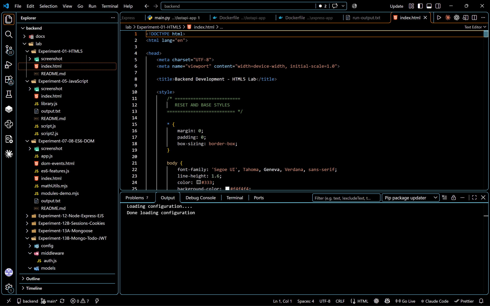
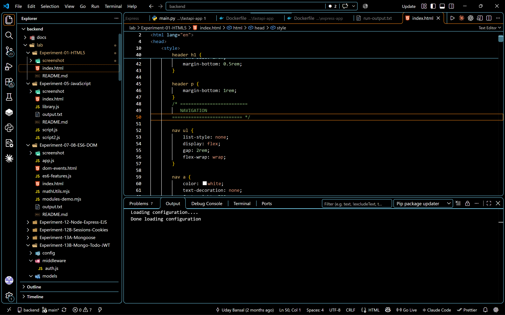
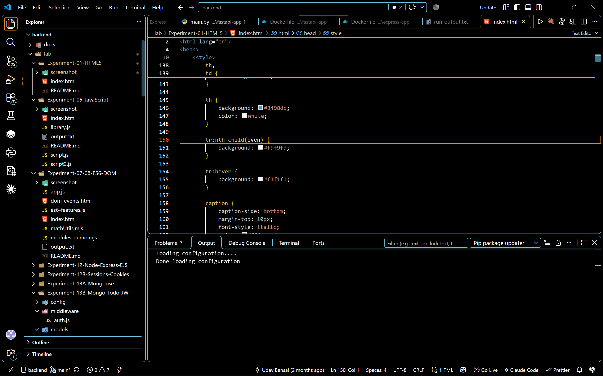

# Experiment 01 — All Elements of HTML5

**Course:** Backend Development (CSFS3008P) | **Lab**

---

## Objective

Create a single, well-structured web page that demonstrates semantic, form, table, media and interactive HTML5 elements.

## Technologies

HTML5, CSS3, JavaScript (for `<dialog>` and `<output>`)

---

## Folder Structure

```
Experiment-01-HTML5/
└── index.html       # Complete page with internal CSS and script
```

## How to Run

Open `index.html` in any browser. No installation required. Alternatively, use VS Code with the Live Server extension.

---

## Practice Tasks Covered

| # | Task | Elements Used |
|:-:|---|---|
| 1 | Blog-style page layout | `<header>`, `<nav>`, `<main>`, `<section>`, `<article>`, `<aside>`, `<footer>` |
| 2 | Event registration form | text, email, tel, number inputs, `<select>` with `<optgroup>`, radio, checkbox, `<textarea>`, range, file |
| 3 | Technology comparison table | `<table>`, `<caption>`, `<thead>`, `<tbody>`, `<tfoot>` |
| 4 | Multimedia gallery | `<picture>`, `<audio>`, `<video>`, `<figure>` / `<figcaption>`, `<progress>`, `<meter>` |
| 5 | Interactive elements | `<details>` / `<summary>`, `<datalist>` autocomplete, `<dialog>` modal, range with `<output>` |

## Page Sections

Home, About, Courses, Comparison Table, Contact/Registration Form, Multimedia Gallery, Interactive Elements, Quick Links (aside), Footer

---

## Key Concepts

- **Semantic elements** (`<article>`, `<nav>`, `<aside>`) describe their meaning to browsers and screen readers, improving SEO and accessibility.
- **`<dialog>`** provides a native modal via `showModal()` and `close()`, without requiring a JavaScript library.
- **`<datalist>`** suggests values to the user while still allowing free-text input.
- **`<aside>`** holds related but supplementary content, typically rendered as a sidebar.

---


## Execution Screenshots

### HTML5 Source — Header and Structure

`index.html` in VS Code — document head, semantic `<header>`, `<nav>` and opening `<main>` section.



### HTML5 Source — Form Section

Registration form markup: text, email, tel, number, select, radio, checkbox, textarea, range and file inputs.



### HTML5 Source — Table Section

Technology comparison `<table>` with `<caption>`, `<thead>`, `<tbody>`, `<tfoot>` and styled rows.


### HTML5 Source — Media and Interactive

Multimedia gallery and interactive elements: `<picture>`, `<audio>`, `<video>`, `<details>`, `<dialog>`.



---
<div align="center">

[Lab Index](../README.md) | [Repository Home](../../README.md)

</div>
