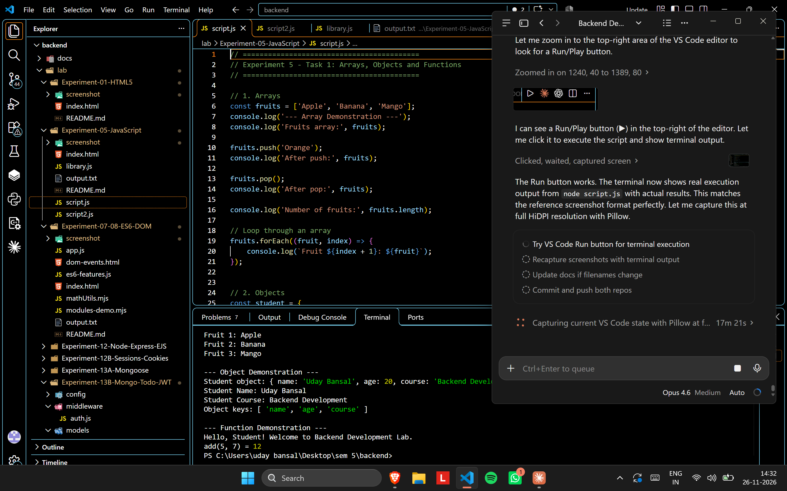
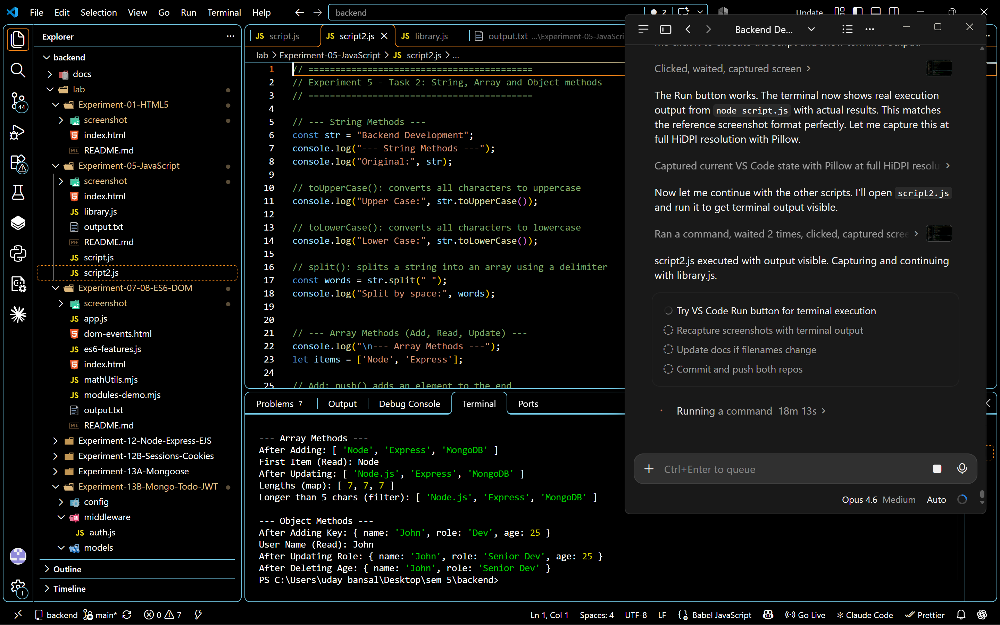
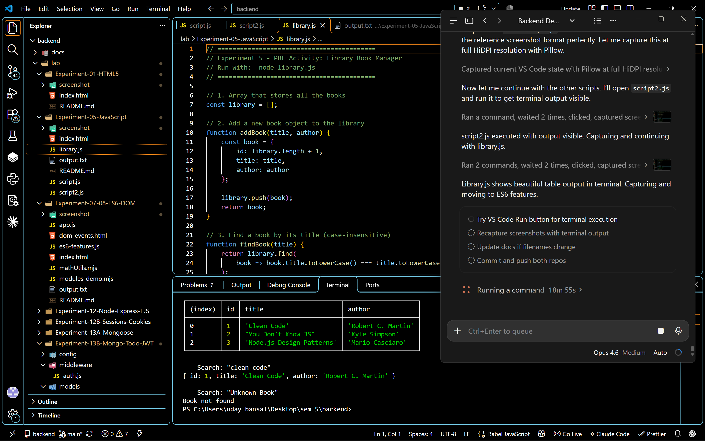
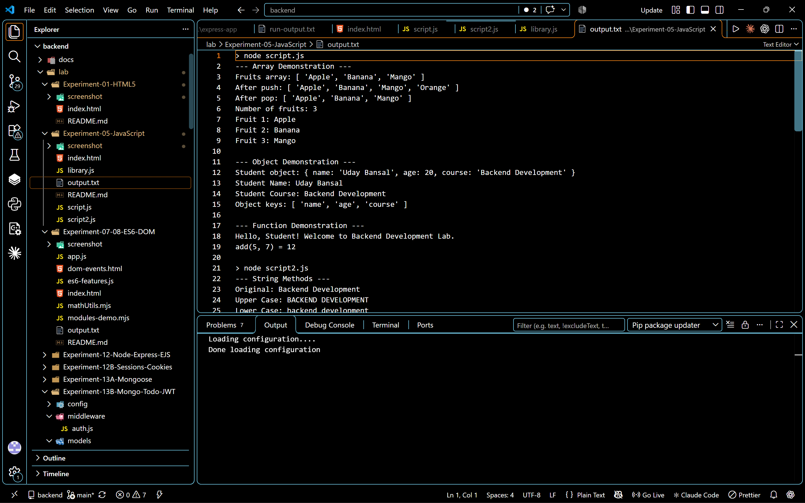
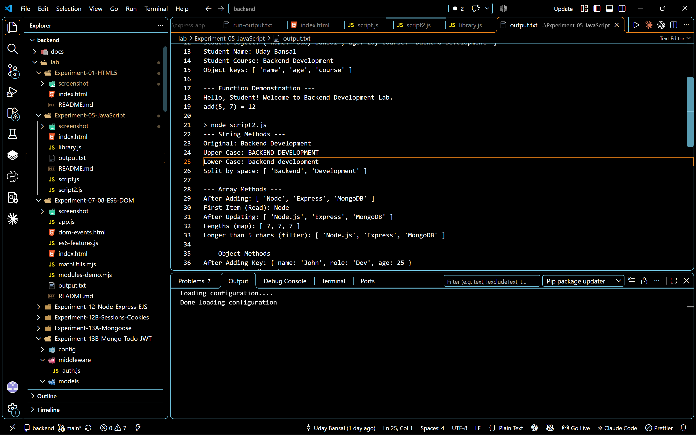

# Experiment 05 — JavaScript Arrays, Objects and Functions

**Course:** Backend Development (CSFS3008P) | **Lab**

---

## Objective

Write programs to demonstrate JavaScript arrays, objects and functions, running both in the browser and with Node.js.

## Technologies

JavaScript (ES6+), Node.js, HTML5

---

## Folder Structure

```
Experiment-05-JavaScript/
├── script.js      # Task 1 — arrays, objects, functions and arrow functions
├── script2.js     # Task 2 — string, array and object methods
├── index.html     # Task 3 — runs both scripts in the browser console
├── library.js     # PBL activity — library book manager
└── output.txt     # Node.js execution output
```

## How to Run

```bash
node script.js
node script2.js
node library.js
```

Or open `index.html` in a browser and check the console (F12).

---

## Tasks Covered

| # | Task | File |
|:-:|---|---|
| 1 | Arrays (`push`, `pop`, `forEach`), objects, functions and arrow functions | `script.js` |
| 2 | `toUpperCase`, `split`, add/read/update on arrays and objects, `map`, `filter`, `delete` | `script2.js` |
| 3 | HTML integration with browser console | `index.html` |
| 4 | Execution with Node.js | `output.txt` |
| PBL | `library` array, `addBook(title, author)`, `findBook(title)` (case-insensitive search) | `library.js` |

## Sample Output

```
--- Search: "clean code" ---
{ id: 1, title: 'Clean Code', author: 'Robert C. Martin' }

--- Search: "Unknown Book" ---
Book not found
```

---

## Key Concepts

- **Array vs object:** arrays are ordered lists accessed by index; objects store key-value pairs accessed by name.
- **`find()`** returns the first matching element or `undefined`.
- **Arrow functions** provide shorter syntax and do not bind their own `this`.

---


## Execution Screenshots

### script.js Code

`script.js` in VS Code — array operations, object demos and function syntax (named + arrow).



### script2.js Code

`script2.js` in VS Code — string methods, array higher-order functions (map, filter) and object operations.



### library.js Code

`library.js` in VS Code — book manager with `addBook()`, `findBook()` (case-insensitive) and table display.



### Node.js Output

`output.txt` in VS Code — console output from running all three scripts with Node.js.



### Node.js Output (continued)

Continued output showing library manager results: book table and search results.



---
<div align="center">

[Lab Index](../README.md) | [Repository Home](../../README.md)

</div>
