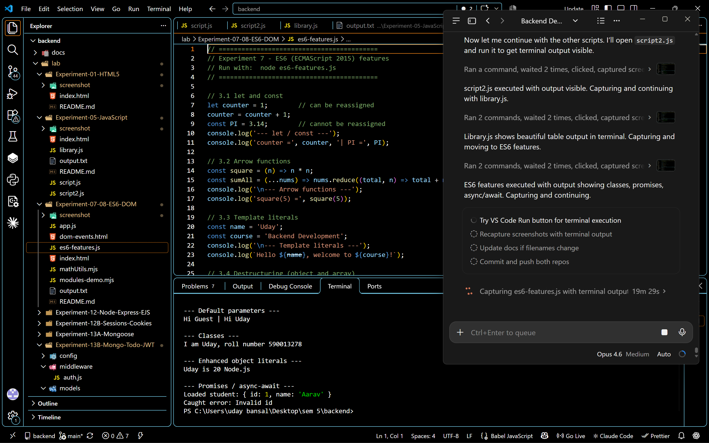
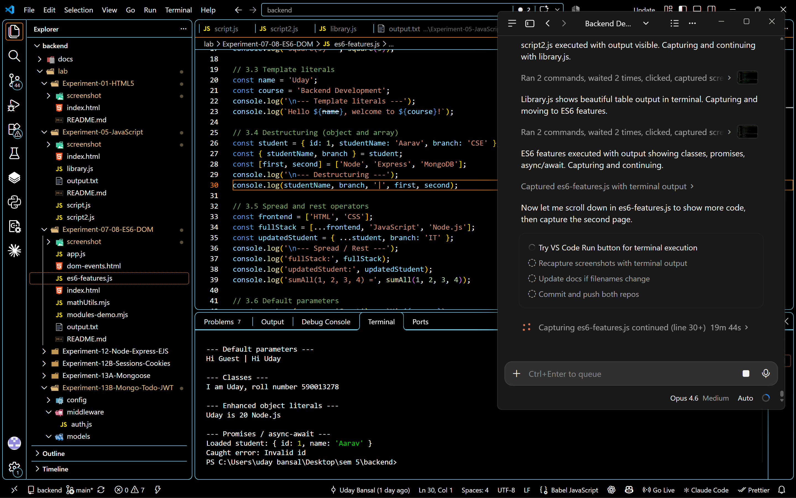
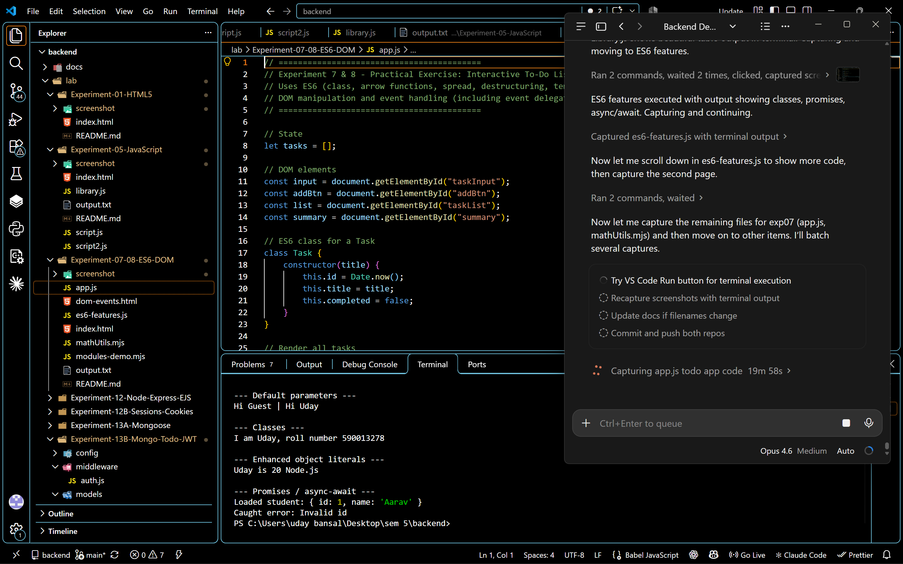
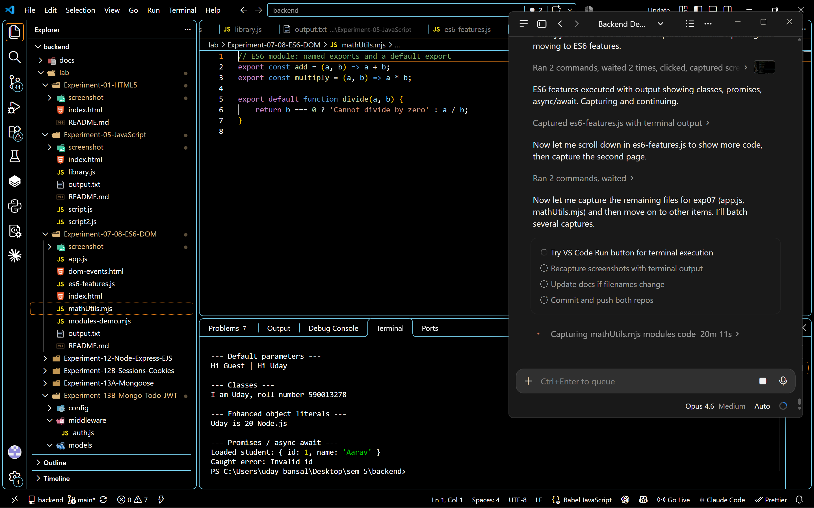
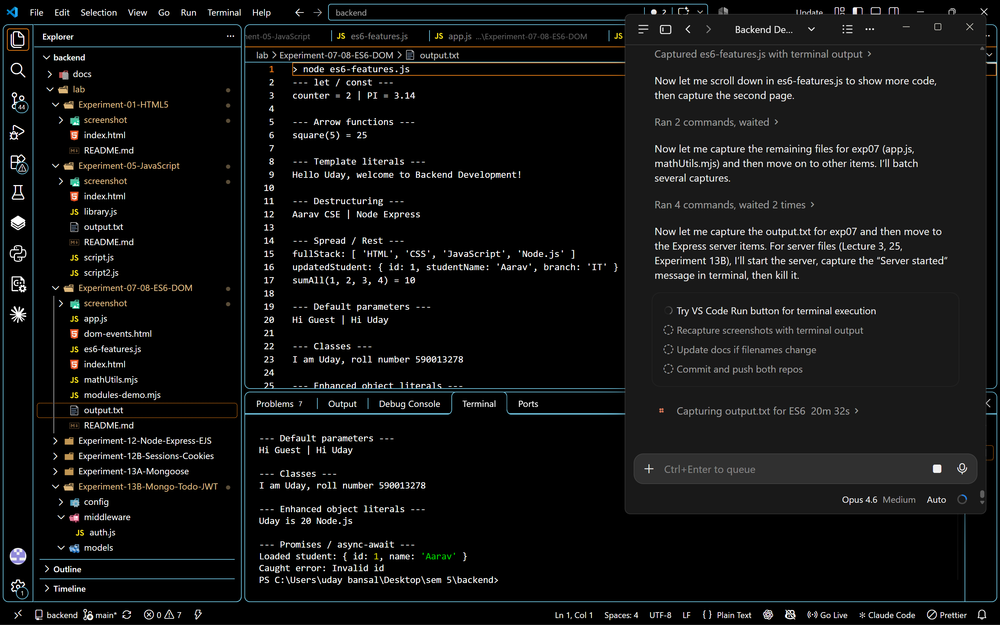

# Experiments 07 and 08 — ES6, DOM Manipulation and Event Handling

**Course:** Backend Development (CSFS3008P) | **Lab**

---

## Objective

Demonstrate modern ES6 JavaScript features (Experiment 7) and DOM manipulation with event handling (Experiment 8), culminating in an interactive To-Do list.

## Technologies

JavaScript (ES6+), HTML5, Node.js

---

## Folder Structure

```
Experiment-07-08-ES6-DOM/
├── es6-features.js     # let/const, arrow functions, template literals, destructuring,
│                       # spread/rest, default params, classes, promises, async/await
├── mathUtils.mjs       # ES6 module — named and default exports
├── modules-demo.mjs    # ES6 module imports
├── dom-events.html     # DOM and event demos (content, attributes, create/remove,
│                       # mouse, keyboard, form submit, bubbling, stopPropagation)
├── index.html          # Interactive To-Do list page
├── app.js              # To-Do logic (class, spread, event delegation)
└── output.txt          # Node.js output of the ES6 demos
```

## How to Run

```bash
node es6-features.js
node modules-demo.mjs
```

Open `dom-events.html` and `index.html` in a browser to test the DOM and To-Do features.

---

## To-Do List Features

| Feature | Implementation |
|---|---|
| Add task (button click or Enter key) | `addTask()` using the spread operator |
| Toggle completed state | Click a task to toggle `classList` via `map()` |
| Delete a task | `filter()` to remove by index |
| Single event listener for all tasks | Event delegation on the `<ul>` with `closest("li")` |
| Progress indicator | Displays "1 of 2 tasks completed" |

---

## Key Concepts

- **`let` / `const`** are block-scoped; `const` prevents reassignment of the binding.
- **Event bubbling:** events travel from the target element up through its parents; `stopPropagation()` halts this.
- **Event delegation:** a single listener on a parent element handles events from all current and future children, reducing the number of listeners needed.
- **ES6 modules:** `export` / `import` provide file-level encapsulation; Node.js uses `.mjs` extension or `"type": "module"` in `package.json`.

---


## Execution Screenshots

### ES6 Features Code

`es6-features.js` in VS Code — let/const, arrow functions, template literals, destructuring, spread/rest.



### ES6 Features (continued)

Continued ES6 code — classes, enhanced object literals, Promises and async/await demonstrations.



### Todo App Code

`app.js` in VS Code — interactive todo list built with ES6 classes, event delegation and DOM manipulation.



### ES Modules Code

`mathUtils.mjs` in VS Code — named and default exports for the ES modules demonstration.



### ES6 Output

`output.txt` in VS Code — console output from all ES6 feature demonstrations and module imports.



---
<div align="center">

[Lab Index](../README.md) | [Repository Home](../../README.md)

</div>
