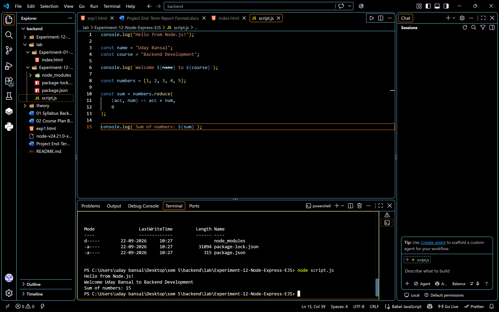
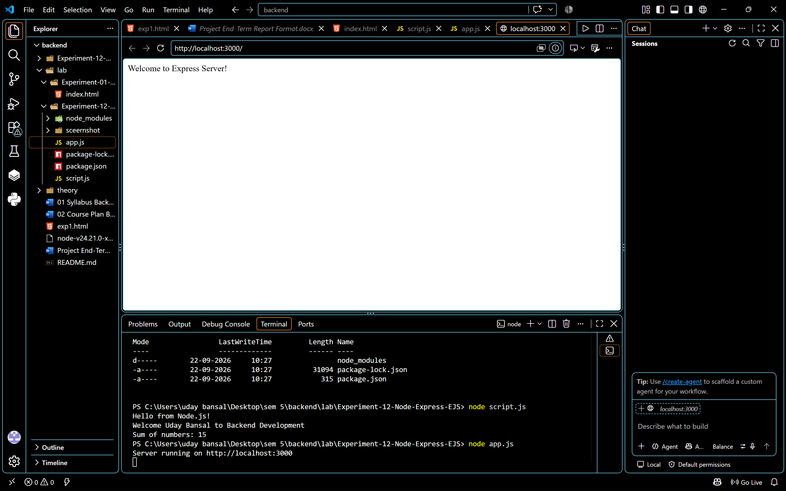
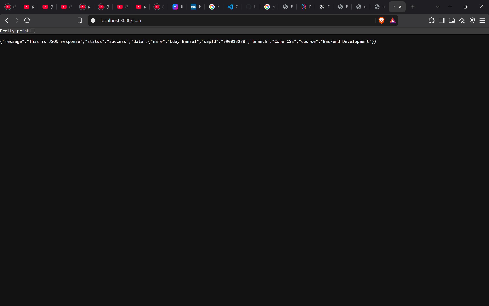
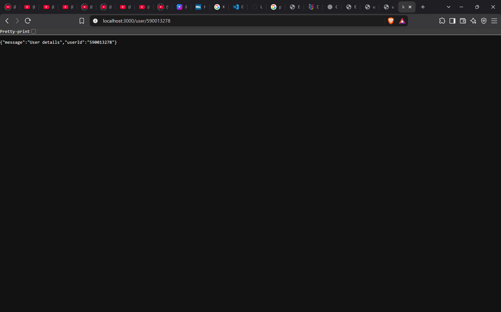

# Experiment 12A — Node.js, npm, Express, nodemon and EJS

**Course:** Backend Development (CSFS3008P) | **Lab**

---

## Objective

Develop server-side applications using Node.js and Express, covering routes, parameters, POST data, a calculator API and EJS template rendering.

## Technologies

Node.js, Express.js, EJS, nodemon

---

## Folder Structure

```
Experiment-12-Node-Express-EJS/
├── app.js              # Express server with all routes
├── script.js           # Plain Node.js script (Part A)
├── nodemon.json        # Auto-restart configuration
├── package.json        # Scripts: start, dev, script
├── views/
│   ├── home.ejs, users.ejs, profile.ejs   # Tutorial templates
│   ├── timetable.ejs                      # Task 4 — course timetable
│   └── register.ejs, result.ejs           # Task 5 — registration form
├── sceernshot/         # Screenshots
└── test-output.txt     # curl test results
```

## How to Run

```bash
npm install
npm start          # node app.js       → http://localhost:3000
npm run dev        # nodemon app.js    → auto-restart on changes
npm run script     # node script.js
```

---

## Lab Tasks

| # | Task | Routes |
|:-:|---|---|
| 1 | Name, roll number and branch as text, HTML and JSON | `GET /text`, `GET /html`, `GET /json` |
| 2 | Calculator (add, subtract, multiply, divide, modulus, power) | `GET /calculate?num1=10&num2=3&operation=modulus` |
| 3 | Student management | `GET /students`, `GET /students/:id` (404), `POST /students/add` (400 validation) |
| 4 | EJS course timetable | `GET /timetable` |
| 5 | Registration form with result page | `GET /register-form`, `POST /register-form` |

Additional tutorial routes: `/`, `/user/:id`, `/product/:category/:id`, `/search?q=`, `POST /register`, `POST /login`, `/home`, `/users`, `/profile/:id`.

## Test Results

```
GET /calculate?num1=2&num2=10&operation=power  →  {"result": 1024}
GET /students/99                                →  {"message": "Student not found"}  [404]
POST /students/add                              →  {"message": "Student added successfully", ...}
```

Full output: [test-output.txt](test-output.txt)

## Screenshots

| Node Script | Express Server |
|:-:|:-:|
|  |  |
| **JSON Response** | **URL Parameter** |
|  |  |

---

## Key Concepts

- `res.send()` sends text/HTML, `res.json()` sends JSON, `res.render()` renders an EJS template.
- `req.params` captures URL parameters (`/students/:id`), `req.query` captures query strings (`?num1=`), `req.body` captures POST data (requires `express.json()` or `express.urlencoded()` middleware).
- EJS tags: `<%= %>` prints escaped output, `<% %>` runs JavaScript, `<%- %>` prints raw HTML.

---

<div align="center">

[Lab Index](../README.md) | [Repository Home](../../README.md)

</div>
