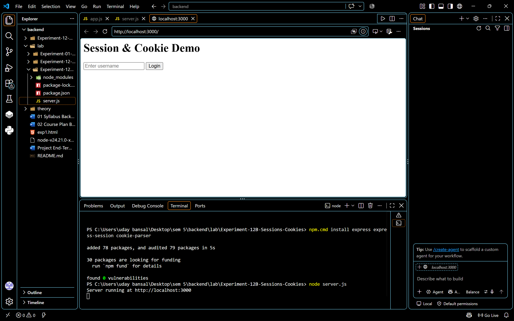
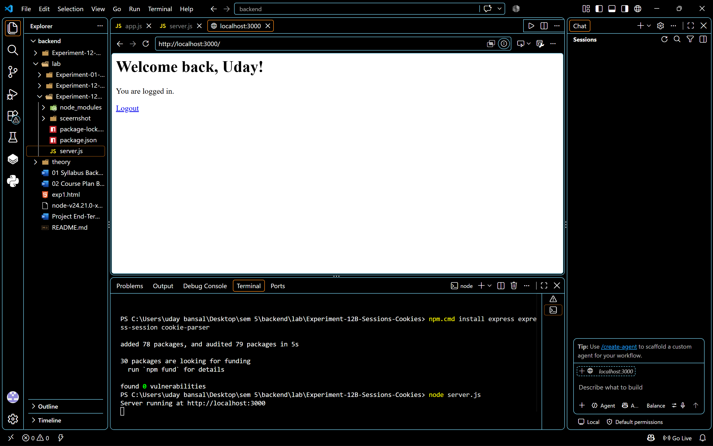
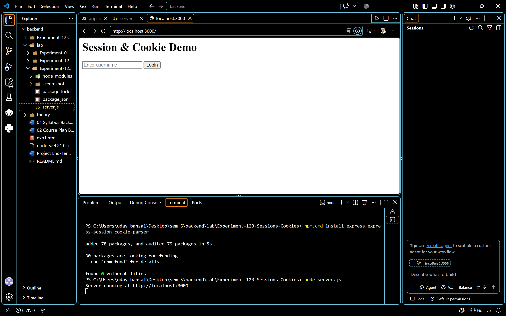
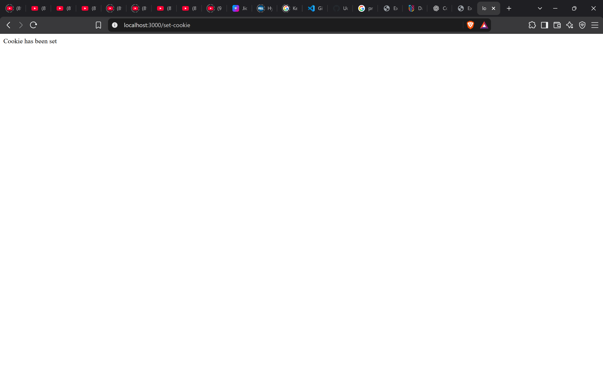
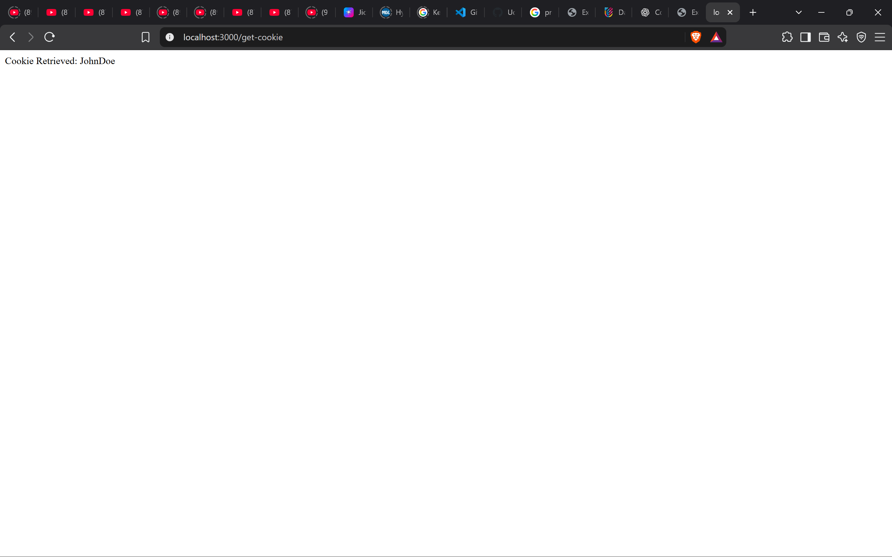

# Experiment 12B — Sessions, Cookies and State Management

**Course:** Backend Development (CSFS3008P) | **Lab**

---

## Objective

Understand how servers maintain state across HTTP requests using `express-session` for server-side sessions and `cookie-parser` for client-side cookies.

## Technologies

Node.js, Express.js, express-session, cookie-parser, bcryptjs

---

## Folder Structure

```
Experiment-12B-Sessions-Cookies/
├── server.js                    # Tutorial: session login/logout, set/get/delete cookie
├── exercise1-login.js           # Exercise 1: register, login, dashboard, logout
├── exercise2-todo.js            # Exercise 2: per-session to-do list + theme cookie
├── exercises-test-output.txt    # curl test results for both exercises
└── sceernshot/                  # Screenshots
```

## How to Run

```bash
npm install
npm start            # server.js          → http://localhost:3000
npm run exercise1    # exercise1-login.js → http://localhost:3001
npm run exercise2    # exercise2-todo.js  → http://localhost:3002
```

---

## Application Features

| Application | Features |
|---|---|
| **Tutorial** (`server.js`) | Session login/logout, `res.cookie()`, `req.cookies`, `res.clearCookie()` |
| **Exercise 1** | Register with bcrypt-hashed passwords, login, protected dashboard via `authMiddleware`, logout with `req.session.destroy()` |
| **Exercise 2** | Per-session to-do list stored in `req.session.todos`, theme cookie (dark/light mode with 30-day expiry) |

## Test Results

| Test | Result |
|---|---|
| `/dashboard` without login | `302` redirect to `/login` |
| Duplicate username or wrong password | Rejected with appropriate message |
| Login, view dashboard, logout, access dashboard again | Greeting shown, then `302` redirect |
| Two browsers (separate cookie jars) | Independent to-do lists |
| `GET /theme/dark` | Sets `theme=dark` cookie with `Max-Age=2592000` |

Full output: [exercises-test-output.txt](exercises-test-output.txt)

## Screenshots

| Server Running | Session Login | Session Logout |
|:-:|:-:|:-:|
|  |  |  |
| **Cookie Set** | **Cookie Retrieved** | **Cookie Deleted** |
|  |  |  |

---

## Session vs Cookie

| Aspect | Session | Cookie |
|---|---|---|
| Stored | On the server (only the session ID `connect.sid` is in the browser) | In the browser |
| Use cases | Login state, shopping cart, to-do list | Small preferences (theme, language) |
| Security | Data hidden from the user | User can read and modify; use `httpOnly`, `secure` and `signed` flags for protection |

---

<div align="center">

[Lab Index](../README.md) | [Repository Home](../../README.md)

</div>
