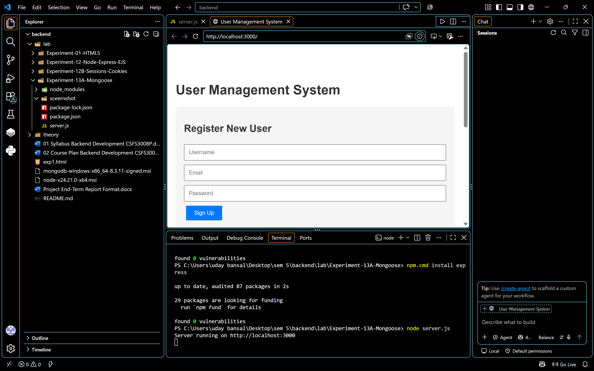
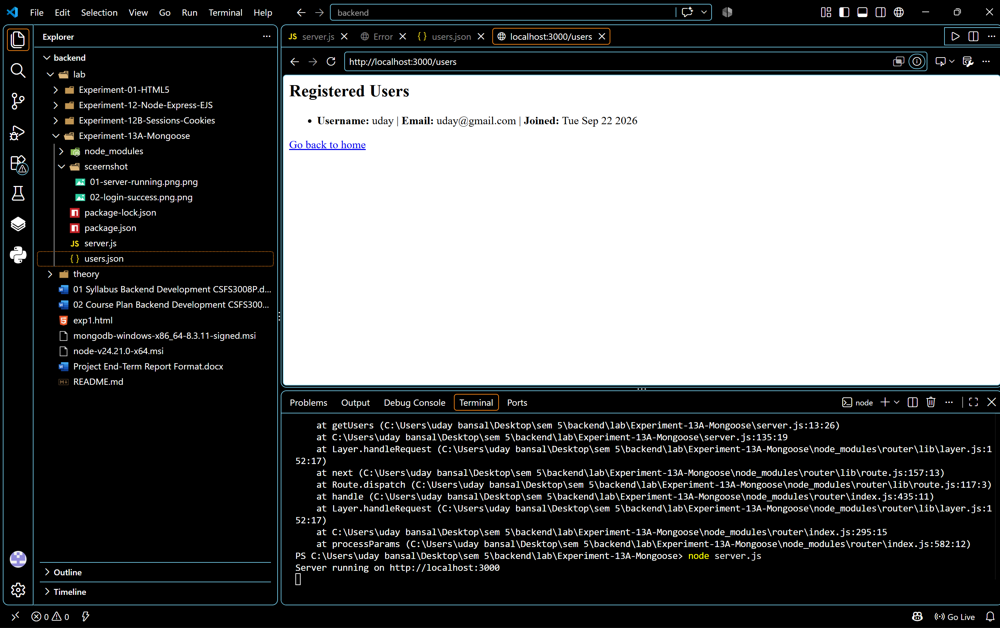
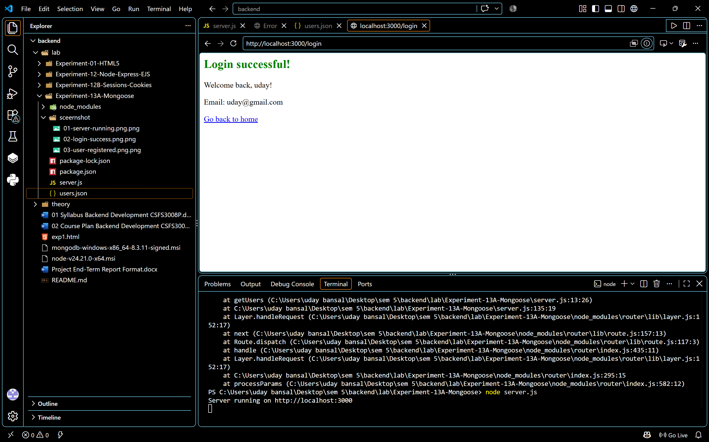

# Experiment 13A — MongoDB + Mongoose User Registration and Login

**Course:** Backend Development (CSFS3008P) | **Lab**

---

## Objective

Build a user management system that stores users in MongoDB through a Mongoose schema and model, with registration, login and listing.

## Technologies

Node.js, Express.js, MongoDB, Mongoose

---

## Folder Structure

```
Experiment-13A-Mongoose/
├── server.js          # Express + Mongoose app
├── users.json         # Data file from the earlier file-based version (no longer used)
├── test-output.txt    # Test run
└── sceernshot/        # Screenshots
```

## How to Run

```bash
npm install
node server.js                       # http://localhost:3000
# MongoDB Atlas instead of local:
MONGO_URL="mongodb+srv://..." node server.js
```

### Installing MongoDB (Windows)

1. Install **MongoDB Community Server** (MSI, Complete, Install as a Service) and **mongosh**.
2. Check: `Get-Service MongoDB` shows *Running*; `mongosh` connects to `127.0.0.1:27017`.
3. Useful commands: `show dbs`, `use userdb`, `db.users.find()`, `db.users.countDocuments()`.

---

## How It Works

| Step | Code |
|---|---|
| Connect | `mongoose.connect(DB_URL)` |
| Schema | `username` and `email` (required, unique), `password` (required), `createdAt` (default `Date.now`) |
| Model | `mongoose.model('User', userSchema)` creates collection `users` |
| Register | `new User({...}).save()` — error code **11000** means duplicate username or email |
| Login | `User.findOne({ username })` + password check |
| List | `User.find()` |

> **Note:** Passwords are stored as plain text to keep this first Mongoose lab simple (as in the handout). Experiment 13B hashes them with bcrypt.

## Test Results

```
POST /signup uday        -> User registered successfully!
POST /signup duplicate   -> Error: Username or email already exists
POST /login wrong pw     -> Incorrect password
POST /login unknown      -> User not found
POST /login ok           -> Login successful! Welcome back, uday
GET  /users              -> Username: uday
```

Full output: [test-output.txt](test-output.txt)

## Screenshots

| Server Running | First Login | User Registered | Login Successful |
|:-:|:-:|:-:|:-:|
|  |  |  |  |

---

<div align="center">

[Lab Index](../README.md) | [Repository Home](../../README.md)

</div>
