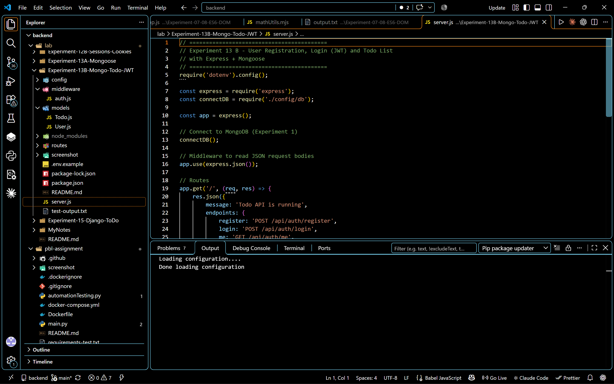
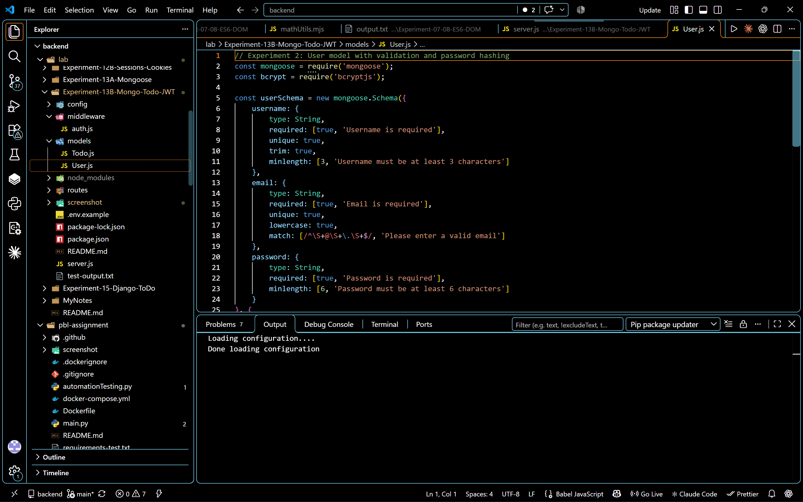
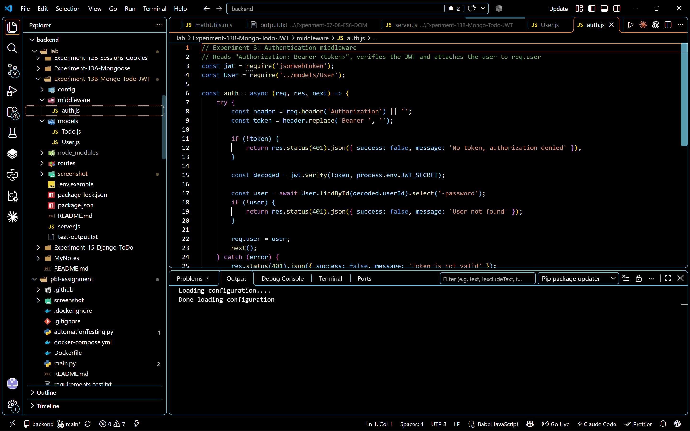
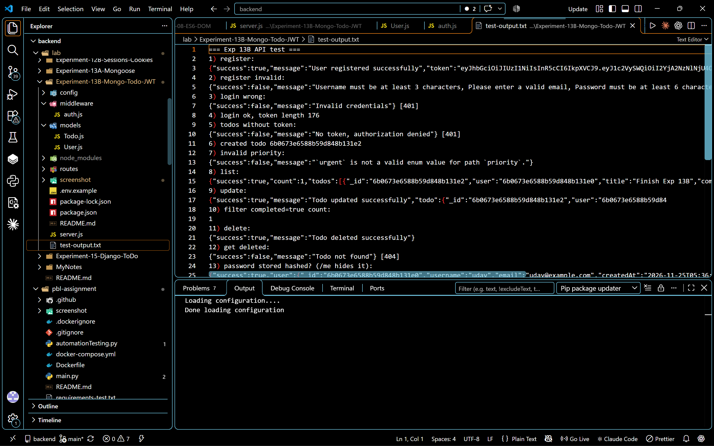

# Experiment 13B — Registration, JWT Login and Todo API

**Course:** Backend Development (CSFS3008P) | **Lab**

---

## Objective

Build a REST API where each user registers, logs in with a JWT and manages only their own todos.

## Technologies

Node.js, Express.js, MongoDB, Mongoose, bcrypt, JSON Web Tokens

---

## Folder Structure

```
Experiment-13B-Mongo-Todo-JWT/
├── config/db.js          # mongoose.connect()
├── models/User.js        # Validation + bcrypt pre('save') + comparePassword()
├── models/Todo.js        # Todo belongs to a user, priority enum
├── middleware/auth.js     # Verifies "Authorization: Bearer <JWT>"
├── routes/auth.js        # register, login, me
├── routes/todos.js       # Todo CRUD
├── server.js
├── .env.example          # Copy to .env (ignored by Git)
└── test-output.txt
```

## How to Run

```bash
npm install
copy .env.example .env     # set MONGODB_URI and JWT_SECRET
npm run dev                # nodemon server.js
```

---

## API Endpoints

| Method | Endpoint | Auth | Purpose |
|:-:|---|:-:|---|
| `POST` | `/api/auth/register` | — | Create user (password hashed), returns JWT |
| `POST` | `/api/auth/login` | — | Returns JWT (valid 1 day) |
| `GET` | `/api/auth/me` | Yes | Current user, without password |
| `GET` | `/api/todos?completed=true` | Yes | List own todos |
| `POST` | `/api/todos` | Yes | Create todo |
| `GET` | `/api/todos/:id` | Yes | Read own todo |
| `PUT` | `/api/todos/:id` | Yes | Update own todo |
| `DELETE` | `/api/todos/:id` | Yes | Delete own todo |

## Test Results

| Check | Result |
|---|---|
| Register | Pass |
| Validation (short username, bad email, short password) | 400 |
| Wrong password | 401 |
| No token | 401 |
| Create, invalid enum, list, update, filter, delete | Pass |
| Deleted todo | 404 |
| `/me` hides the password hash | Pass |

Full output: [test-output.txt](test-output.txt)

---

## Key Concepts

- **bcrypt** — one-way salted hash; plain passwords are never stored or compared directly.
- **JWT** — signed `header.payload.signature`; the server verifies it with `JWT_SECRET` without needing session storage (stateless).
- Every todo query includes `user: req.user._id`, so users cannot see or delete others' todos.

---


## Execution Screenshots

### Server Code

`server.js` in VS Code — Express app with MongoDB connection, JWT auth middleware and route mounting.



### User Model Code

`models/User.js` in VS Code — Mongoose schema with bcrypt pre-save hook and `comparePassword()` method.



### Auth Middleware Code

`middleware/auth.js` in VS Code — JWT verification, Bearer token extraction and `req.user` injection.



### Test Output

`test-output.txt` in VS Code — full test suite results: registration, login, CRUD, validation and security checks.



---
<div align="center">

[Lab Index](../README.md) | [Repository Home](../../README.md)

</div>
