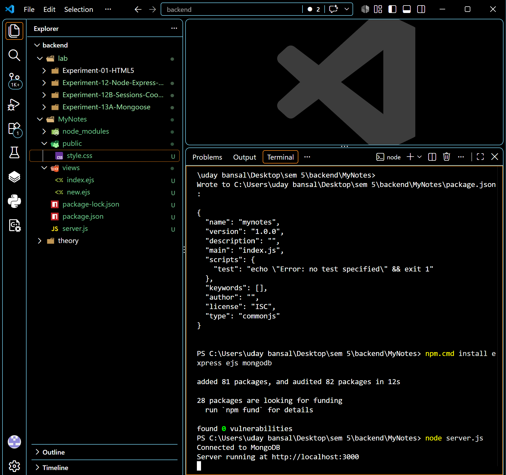
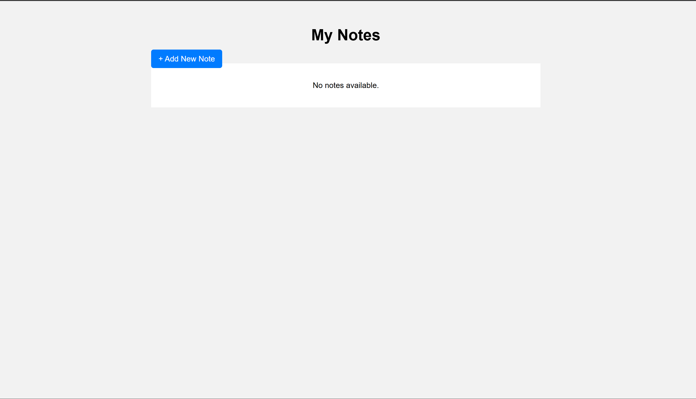
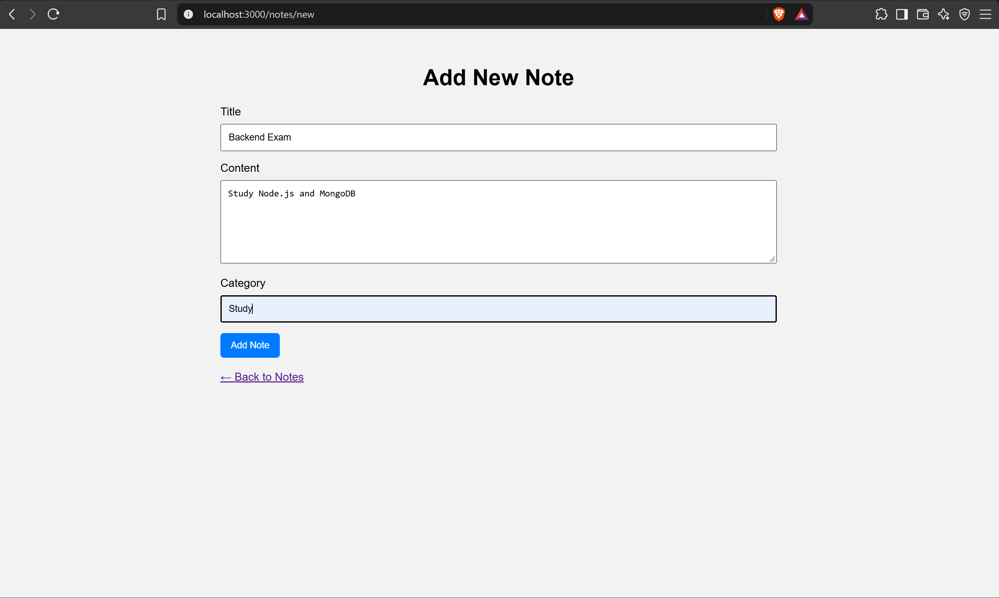
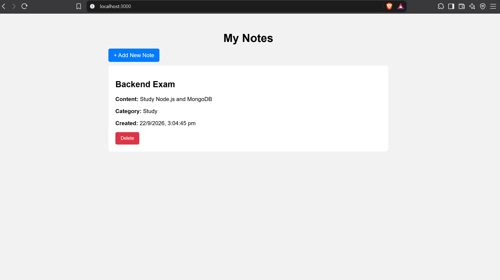

# MyNotes — Mid-Semester Lab Exam (Set A)

**Course:** Backend Development (CSFS3008P) | **Lab Exam**

---

## Objective

Build a notes application that adds, lists and deletes notes stored in MongoDB, rendered with EJS.

## Technologies

Node.js, Express.js, EJS, MongoDB (native driver)

---

## Folder Structure

```
MyNotes/
├── server.js          # Express routes + MongoDB driver
├── views/
│   ├── index.ejs      # List of notes
│   └── new.ejs        # Add-note form
├── public/style.css
└── screenshot/        # Screenshots
```

## How to Run

```bash
npm install
node server.js       # MongoDB must be running on 127.0.0.1:27017
```

---

## Routes

| Method | Route | Purpose |
|:-:|---|---|
| `GET` | `/` | Display all notes (title, content, category, date, delete button) |
| `GET` | `/notes/new` | Add-note form |
| `POST` | `/notes` | Validate title and content, insert, redirect |
| `POST` | `/notes/:id/delete` | Delete the note by its `ObjectId` |

## Screenshots

| Server Running | Empty Notes |
|:-:|:-:|
|  |  |
| **Add-Note Form** | **Filled Form** |
|  |  |

---

<div align="center">

[Lab Index](../README.md) | [Repository Home](../../README.md)

</div>
