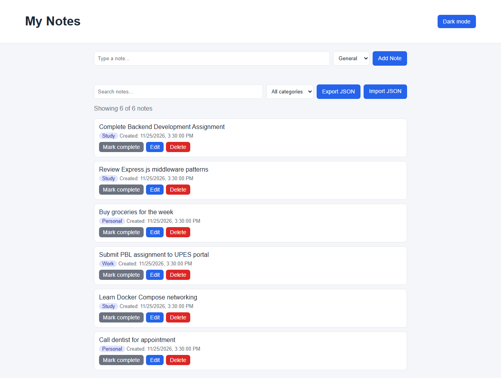
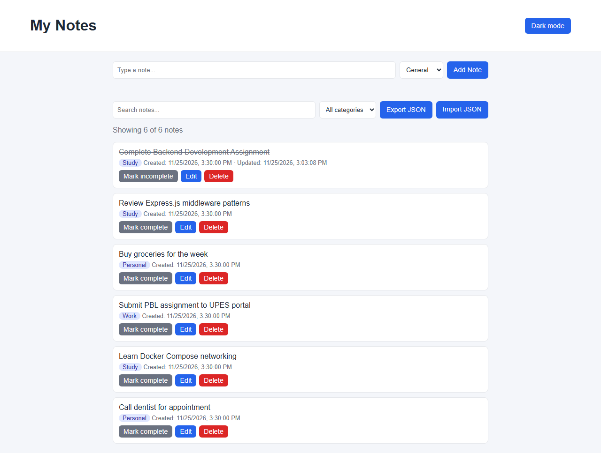
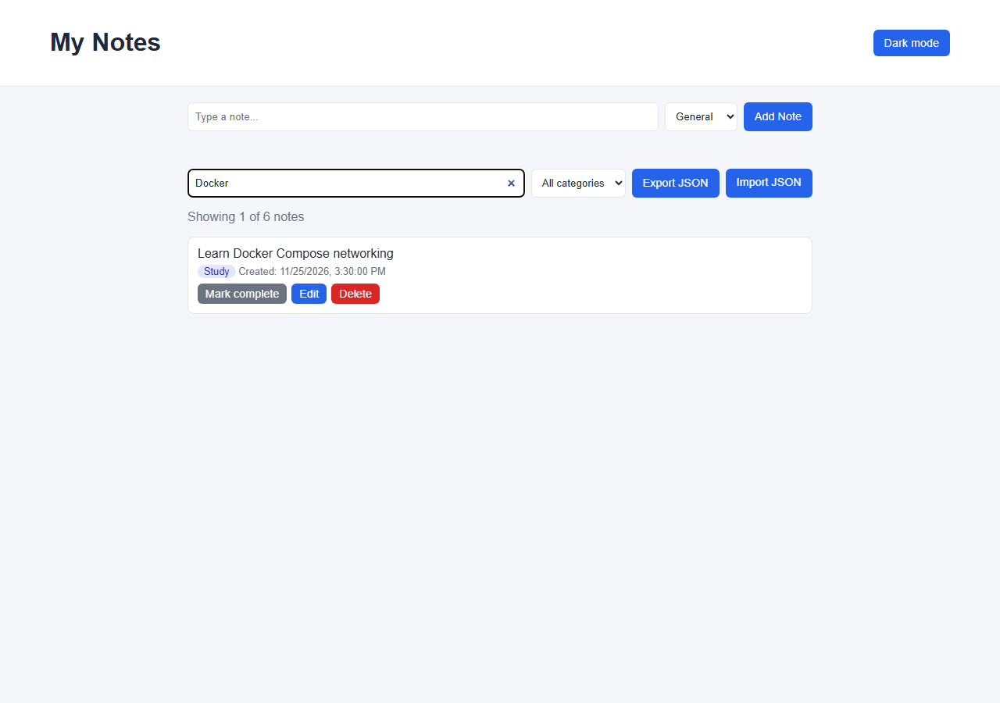
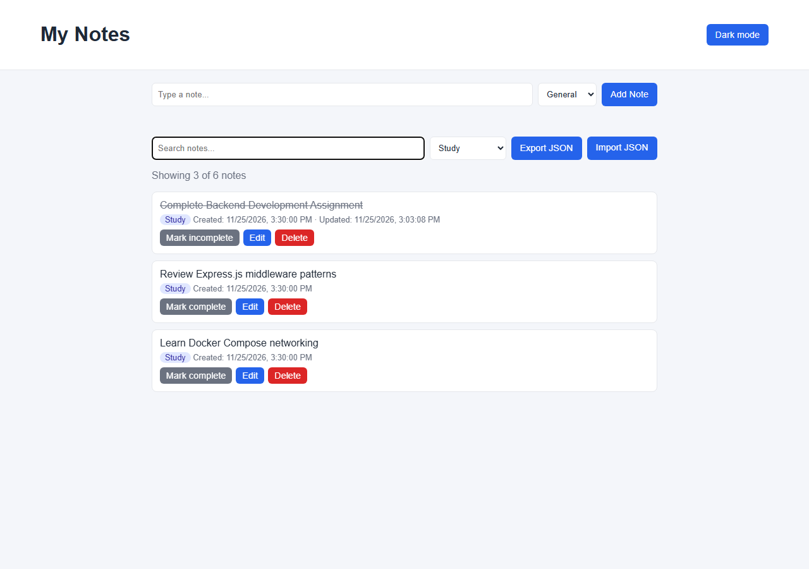
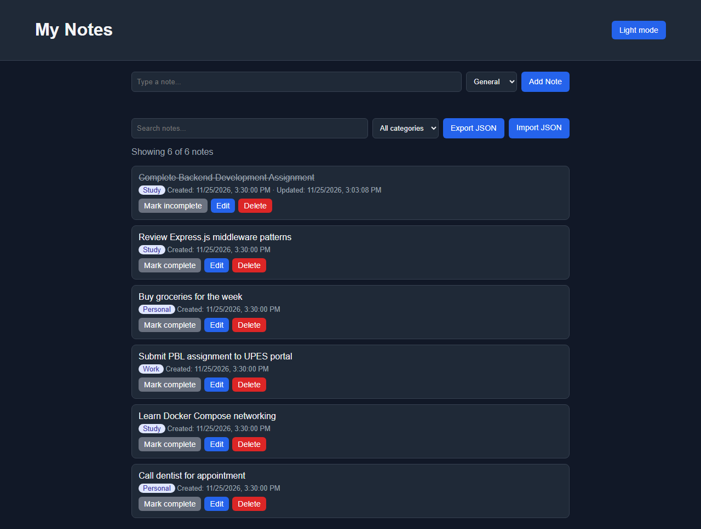

# Assignment I — Notes App with localStorage

**Course:** Backend Development (CSFS3008P) | **Unit:** 1 | **Student:** Uday Bansal (590013278)

---

## Overview

A complete notes application that runs entirely in the browser using HTML, CSS and vanilla JavaScript. All data is persisted in `localStorage`, requiring no server or database. This assignment implements the final task from Lecture 7 (Web Storage and JSON).

| | |
|---|---|
| **Source** | Lecture 7, Section 12 — *Final Task: Build a Notes App* |
| **Run** | Open `index.html` in any browser (or use VS Code Live Server) |
| **Storage** | `localStorage["notes"]` (JSON array) and `localStorage["theme"]` (light/dark) |

---

## Folder Structure

```
Assignment 1/
├── index.html          # Page layout: form, toolbar, notes list
├── style.css           # Light and dark themes using CSS custom properties
├── app.js              # All application logic (244 lines)
├── README.md
└── screenshot/         # Execution screenshots
    ├── assignment-1-notes-light-mode.png
    ├── assignment-1-completed-note.png
    ├── assignment-1-search.png
    ├── assignment-1-category-filter.png
    └── assignment-1-dark-mode.png
```

---

## Note Data Structure

Each note is stored as a JSON object in the `notes` array:

```json
{
  "id": 1795585425744,
  "text": "Complete Backend Assignment",
  "category": "Study",
  "completed": false,
  "createdAt": "2026-11-25T10:00:00.000Z",
  "updatedAt": null
}
```

- **`id`** — generated by `Date.now()`, used to identify notes for edit and delete operations
- **`updatedAt`** — set to the current timestamp when the note is edited or marked complete

---

## Features Implemented

### Required Features

| Feature | Function | Description |
|---|---|---|
| Create a note | `addNote()` | Validates input (rejects empty text), creates a note object and saves it |
| Display notes on load | `renderNotes()` | Called by `window.onload`, loads notes from localStorage and renders cards |
| Edit a note | `editNote(id)` | Opens a prompt with existing text, updates `text` and `updatedAt` |
| Delete a note | `deleteNote(id)` | Filters the note array to remove the matching id |
| Persist across refresh | `saveNotes()` | Calls `localStorage.setItem("notes", JSON.stringify(notes))` after every change |

### Stretch Goals

| Feature | Status | Implementation |
|---|:-:|---|
| Mark complete/incomplete | Done | `toggleComplete(id)` flips `completed`; CSS applies strikethrough |
| Search notes | Done | `renderNotes()` filters by text content on each keystroke |
| Category filter | Done | Dropdown filters notes by General, Study, Personal or Work |
| Import/export JSON | Done | Export creates a downloadable `notes.json` via Blob; Import reads with FileReader and deduplicates by id |
| Dark/light mode | Done | Toggles a `dark` class on `<body>`; theme preference saved in `localStorage["theme"]` |
| Drag to reorder | Not done | Listed as optional in the assignment |

### Security

All note cards are built using `document.createElement()` and `textContent`, not `innerHTML`. Typing `<script>alert(1)</script>` as a note displays it as plain text — the app is safe from XSS.

---

## Screenshots

### Light Mode — All Notes

The app displaying six notes across Study, Personal and Work categories, with Add Note form, search bar, category filter and Export/Import buttons visible.



### Completed Note

The first note marked as complete, showing strikethrough text, an "Updated" timestamp and the "Mark incomplete" button.



### Search

Searching for "Docker" filters the list to show only the matching note.



### Category Filter

Filtering by "Study" shows only the three Study-category notes.



### Dark Mode

The full app in dark mode, with the theme toggle showing "Light mode" and all notes rendered against a dark background.



---

## How to Run

1. Open `index.html` in a browser (double-click, or right-click and select "Open with Live Server" in VS Code).
2. Add notes using the input field and category dropdown.
3. Use the search bar and filter dropdown to find specific notes.
4. Click **Dark mode** to switch themes.
5. Use **Export JSON** to download notes and **Import JSON** to load them from a file.

No installation, no server, no dependencies.

---

## Why localStorage Has Limitations

This assignment demonstrates client-side storage, which has inherent constraints:

- Data lives in a single browser and cannot sync across devices
- Users can clear or manually edit localStorage through DevTools
- Storage is limited to approximately 5 MB
- There is no authentication or server-side validation

A backend with a database addresses each of these limitations, which is the direction the course takes in later units.

---

<div align="center">

[Assignments Index](../README.md) | [Theory Index](../../README.md) | [Repository Home](../../../README.md)

</div>
