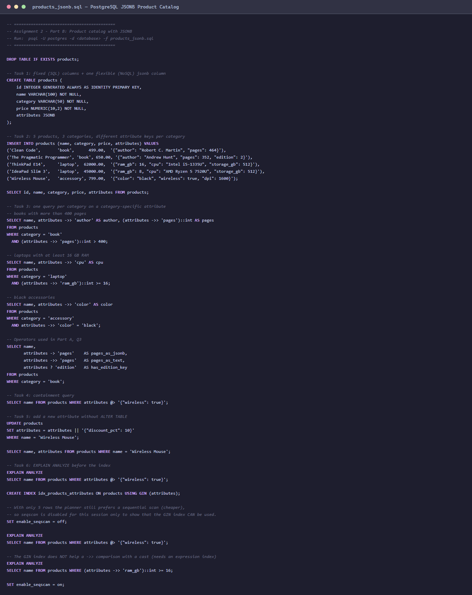
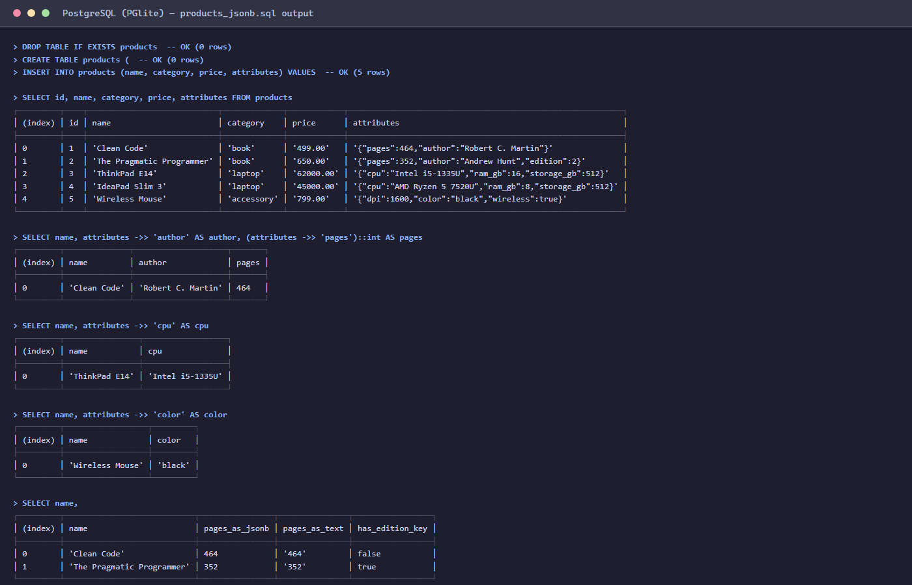
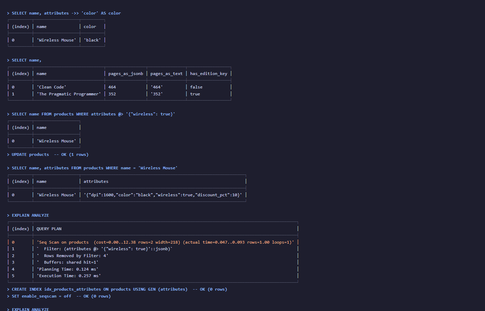
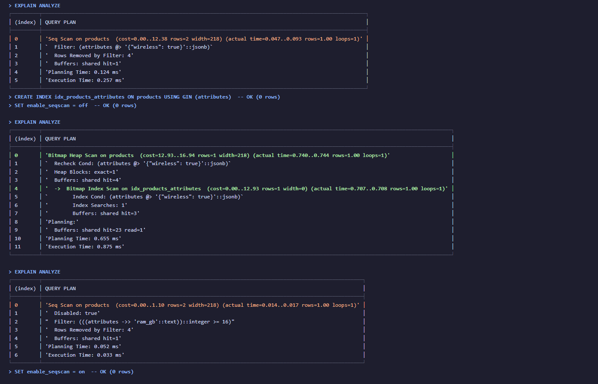
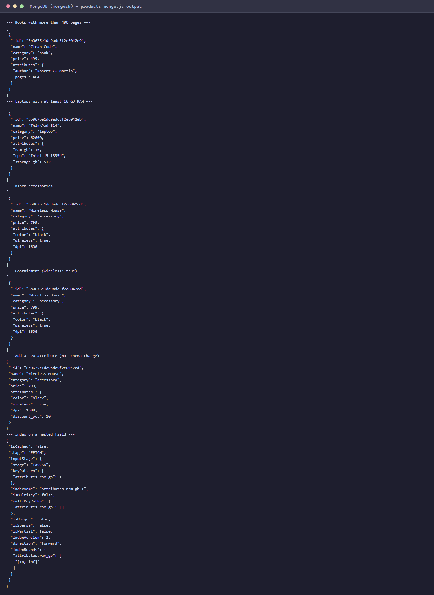

# Assignment II — PostgreSQL as SQL + NoSQL with JSONB

**Course:** Backend Development (CSFS3008P) | **Unit:** 2 | **Student:** Uday Bansal (590013278)

---

## Overview

This assignment explores how PostgreSQL's `jsonb` data type allows a single relational database to handle both structured (SQL) and flexible (NoSQL) data. It includes five conceptual questions (Part A) and a hands-on product catalog exercise with seven tasks (Part B), ending with a MongoDB comparison.

| | |
|---|---|
| **Source** | Theory Assignment 2 — Part A (5 conceptual questions, 150-250 words each) and Part B (7 practical tasks) |
| **Submission** | [Assignment 2 PostgreSQL as SQL and NoSQL with JSONB.md](<Assignment 2 PostgreSQL as SQL and NoSQL with JSONB.md>) |
| **Execution** | SQL ran on PGlite 0.6 (PostgreSQL 19 compiled to WebAssembly); MongoDB script ran against a local test server |

---

## Folder Structure

```
Assignment 2/
├── Assignment 2 PostgreSQL as SQL and NoSQL with JSONB.md   # Full submission (Part A + Part B)
├── products_jsonb.sql      # PostgreSQL script: schema, inserts, queries, GIN index, EXPLAIN ANALYZE
├── postgres-output.txt     # Actual PostgreSQL execution output
├── products_mongo.js       # MongoDB equivalent (mongosh script)
├── mongo-output.txt        # Actual MongoDB execution output
├── README.md
└── screenshot/
    ├── assignment-2-sql-file.png
    ├── assignment-2-postgres-products.png
    ├── assignment-2-postgres-queries.png
    ├── assignment-2-postgres-explain.png
    └── assignment-2-mongodb-output.png
```

---

## Part A — Conceptual Questions

| Question | Topic | Key Points |
|:-:|---|---|
| 1 | `json` vs `jsonb` | `json` stores exact text (re-parses every read); `jsonb` stores binary (parse once at write, faster reads, supports indexes) |
| 2 | SQL + NoSQL in one table | Fixed typed columns (id, name, price) + one `jsonb` column for flexible per-row attributes |
| 3 | JSONB operators | `->` returns jsonb, `->>` returns text, `@>` containment check, `?` key existence |
| 4 | GIN index impact | Speeds up `@>` and `?` queries; does not help `->>` range comparisons (needs expression index) |
| 5 | PostgreSQL vs MongoDB | PostgreSQL: full ACID, native joins, schema enforcement; MongoDB: built-in sharding, flexible schema, natural JSON |

---

## Part B — Hands-on Tasks

### Product Catalog Schema

The `products` table combines strict relational columns with a flexible JSONB column:

```sql
CREATE TABLE products (
    id         INTEGER GENERATED ALWAYS AS IDENTITY PRIMARY KEY,
    name       VARCHAR(100) NOT NULL,
    category   VARCHAR(50)  NOT NULL,
    price      NUMERIC(10,2) NOT NULL,
    attributes JSONB
);
```

### Sample Data (5 products, 3 categories)

| Product | Category | Price | Attributes |
|---|---|---:|---|
| Clean Code | book | 499.00 | `{"author": "Robert C. Martin", "pages": 464}` |
| The Pragmatic Programmer | book | 650.00 | `{"author": "Andrew Hunt", "pages": 352, "edition": 2}` |
| ThinkPad E14 | laptop | 62,000.00 | `{"ram_gb": 16, "cpu": "Intel i5-1335U", "storage_gb": 512}` |
| IdeaPad Slim 3 | laptop | 45,000.00 | `{"ram_gb": 8, "cpu": "AMD Ryzen 5 7520U", "storage_gb": 512}` |
| Wireless Mouse | accessory | 799.00 | `{"color": "black", "wireless": true, "dpi": 1600}` |

### Tasks Summary

| Task | Description | Key SQL |
|:-:|---|---|
| 1 | Create the products table | `CREATE TABLE products (...)` |
| 2 | Insert 5 products across 3 categories | `INSERT INTO products ...` with different JSONB keys per category |
| 3 | Per-category attribute queries | Books >400 pages, laptops >=16 GB RAM, black accessories |
| 4 | Containment query | `WHERE attributes @> '{"wireless": true}'` |
| 5 | Add attribute without ALTER TABLE | `attributes \|\| '{"discount_pct": 10}'` |
| 6 | GIN index + EXPLAIN ANALYZE | Seq Scan before index, Bitmap Index Scan after |
| 7 | MongoDB comparison | Same queries in mongosh, compared syntax and indexing |

---

## Screenshots

### SQL File

The `products_jsonb.sql` script with syntax-highlighted schema creation, inserts and JSONB queries.



### PostgreSQL Output — Products Table and Queries

Table creation, all 5 products displayed, then per-category JSONB queries returning correct results.



### PostgreSQL Output — JSONB Operator Queries

Results of `->>`, `@>`, `?` operators and the `||` merge update.



### EXPLAIN ANALYZE — Before and After GIN Index

The key comparison:
- **Before index:** `Seq Scan on products` (0.257 ms)
- **After GIN index:** `Bitmap Index Scan on idx_products_attributes` (uses the index)
- **Range query (`->>` with cast):** Still `Seq Scan` (GIN cannot serve cast/range queries)



> **Note:** With only 5 rows, PostgreSQL's query planner correctly prefers a sequential scan even when the index exists. `SET enable_seqscan = off` was used only to demonstrate that the GIN index is usable. The real performance benefit appears on larger tables.

### MongoDB Output

The same product catalog in MongoDB (mongosh), showing equivalent queries with dot-notation syntax and direct type comparisons.



---

## How to Run

```bash
# PostgreSQL (requires a running PostgreSQL server or PGlite)
psql -U postgres -d <database> -f products_jsonb.sql

# MongoDB (requires mongosh connected to a MongoDB instance)
mongosh --file products_mongo.js
```

---

## Key Differences: PostgreSQL JSONB vs MongoDB

| Aspect | PostgreSQL JSONB | MongoDB |
|---|---|---|
| Syntax | Operators `->`, `->>`, `@>` with casts (`::int`) | Dot notation, values keep their type |
| Numeric comparison | `(attributes ->> 'ram_gb')::int >= 16` | `{ "attributes.ram_gb": { $gte: 16 } }` |
| Indexing | One GIN index covers all keys for `@>`/`?`; range queries need expression indexes | One B-tree index per field path; range queries use it directly |
| Updates | `attributes \|\| '{...}'` or `jsonb_set()` | `$set` on a dotted path |
| Joins | Native SQL joins with other tables | `$lookup` (slower, limited) |
| Transactions | Full ACID across tables | Multi-document transactions exist but add overhead |

**Conclusion:** For this catalog both work. MongoDB queries are shorter to write, but PostgreSQL keeps `price` as a validated numeric column and can join products with orders in the same database — which is why PostgreSQL + JSONB is a good choice for mostly-relational applications with some flexible data.

---

<div align="center">

[Assignments Index](../README.md) | [Theory Index](../../README.md) | [Repository Home](../../../README.md)

</div>
