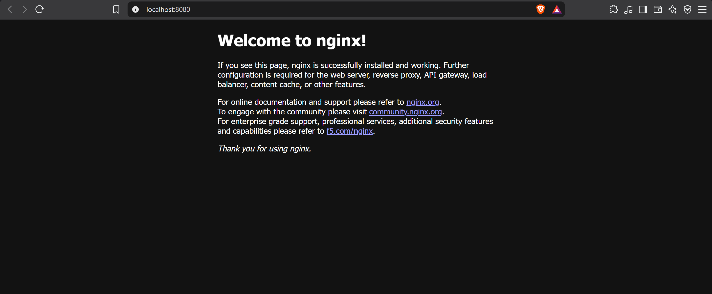
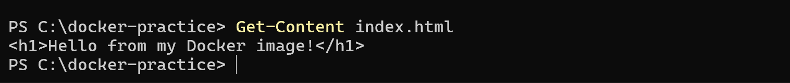
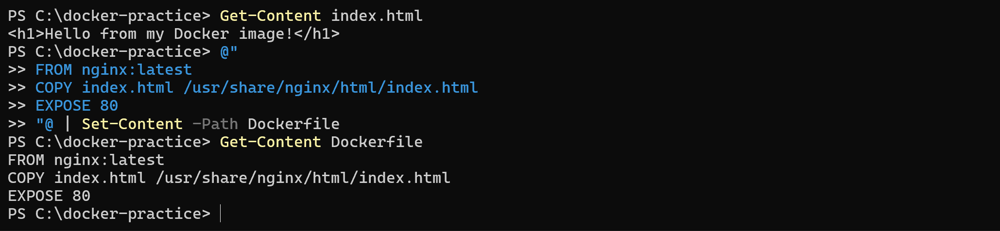
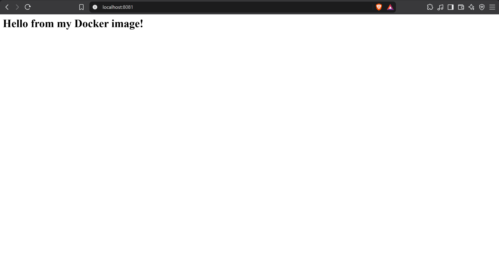
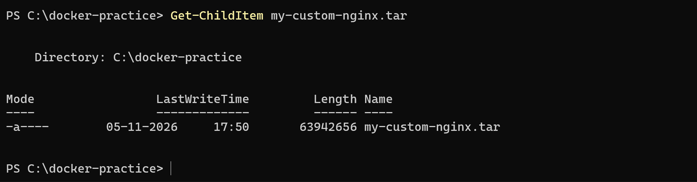
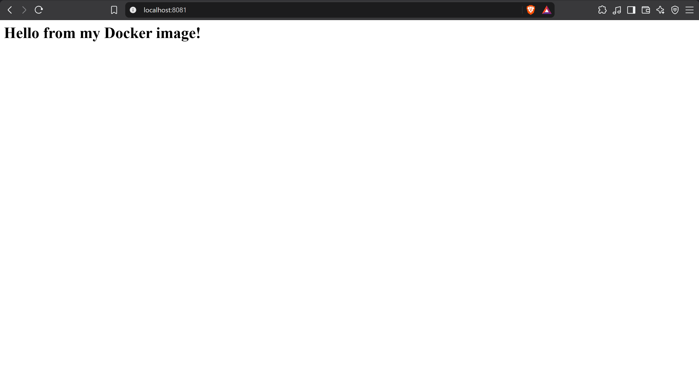

# Docker Basic Commands

**Unit 4:** Deployment, CI/CD and Scaling

---

## Objective

First steps with Docker: running containers, writing a Dockerfile and moving images between machines.

## Technologies

Docker, nginx, Ubuntu

---

## Steps Performed

| # | Step | Example Command |
|:-:|---|---|
| 1 | Run an nginx container and open it in the browser | `docker run -d -p 8080:80 nginx` |
| 2 | Serve a custom HTML page | Create `index.html`, copy it into the container |
| 3 | Write a Dockerfile | `FROM nginx` + `COPY index.html /usr/share/nginx/html/` |
| 4 | Build and run the custom image | `docker build -t my-custom-nginx:v1 .` then `docker run` |
| 5 | Export the image to a file | `docker save -o my-custom-nginx.tar my-custom-nginx:v1` |
| 6 | Restore the image and run it again | `docker load -i my-custom-nginx.tar` |

## Screenshots

| nginx Output | Custom HTML File |
|:-:|:-:|
|  |  |
| **Dockerfile Created** | **Custom Image Output** |
|  |  |
| **Image Export** | **Image Restore** |
|  |  |

## Command Cheat Sheet

| Command | Purpose |
|---|---|
| `docker ps` / `docker ps -a` | Running / all containers |
| `docker images` | Local images |
| `docker logs <name>` | Container output |
| `docker exec -it <name> sh` | Shell inside a running container |
| `docker start -ai <name>` | Re-attach to a stopped container |
| `docker commit <name> <image>` | Save container changes as a new image |
| `docker stop` / `docker rm` / `docker rmi` | Stop / remove container / remove image |
| `docker save` / `docker load` | Export / import an image as a `.tar` file |

---

[Theory Index](../README.md) | [Lectures 37-39](../Lecture%2037-39_Docker_Deployment/README.md) | [Repository Home](../../README.md)

