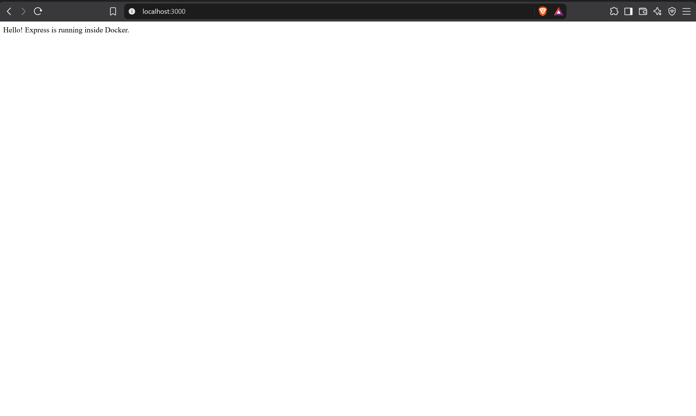
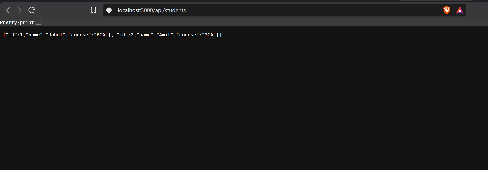
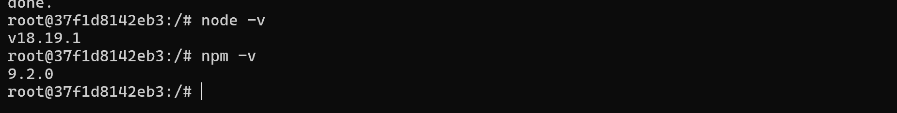
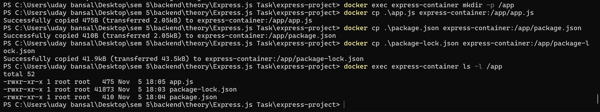
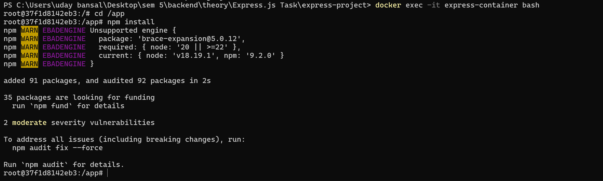
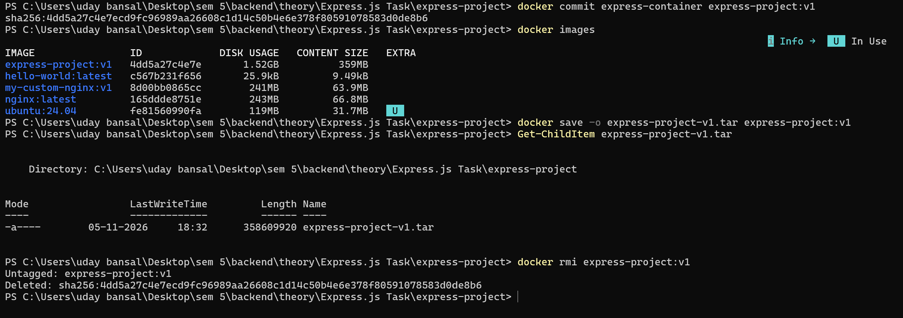
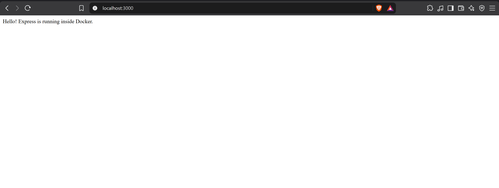
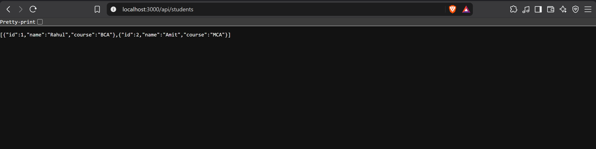

# Express.js Task — Containerizing an Express App

**Unit 4:** Deployment, CI/CD and Scaling

---

## Objective

Build a small Express API, test it locally, package it into a Docker image on Ubuntu, export and run again.

## Technologies

Node.js, Express.js, Docker, Ubuntu

---

## Folder Structure

```
Express.js Task/
├── express-project/
│   ├── app.js
│   └── package.json     # scripts: start, dev
└── screenshots/         # 8 screenshots of every step
```

## Routes

| Method | Route | Response |
|:-:|---|---|
| `GET` | `/` | `Hello! Express is running inside Docker.` |
| `GET` | `/api/students` | JSON list of students |

## How to Run

```bash
cd express-project
npm install
npm start                       # http://localhost:3000
```

---

## Steps Performed

| # | Step |
|:-:|---|
| 1 | Test the app locally |
| 2 | Check `/api/students` |
| 3 | Check Node.js and npm versions on Ubuntu |
| 4 | Copy the project files into the build folder |
| 5 | Install dependencies |
| 6 | Build and export the Docker image (`express-project-v1.tar`) |
| 7 | Run the container — home page |
| 8 | Run the container — students API |

## Screenshots

| Local Test | Students API |
|:-:|:-:|
|  |  |
| **Node and npm Versions** | **Files Copied** |
|  |  |
| **Dependencies Installed** | **Image Export** |
|  |  |
| **Docker — Home Page** | **Docker — Students API** |
|  |  |

---

<div align="center">

[Theory Index](../README.md) | [Lectures 37-39](../Lecture%2037-39_Docker_Deployment/README.md) | [Repository Home](../../README.md)

</div>
