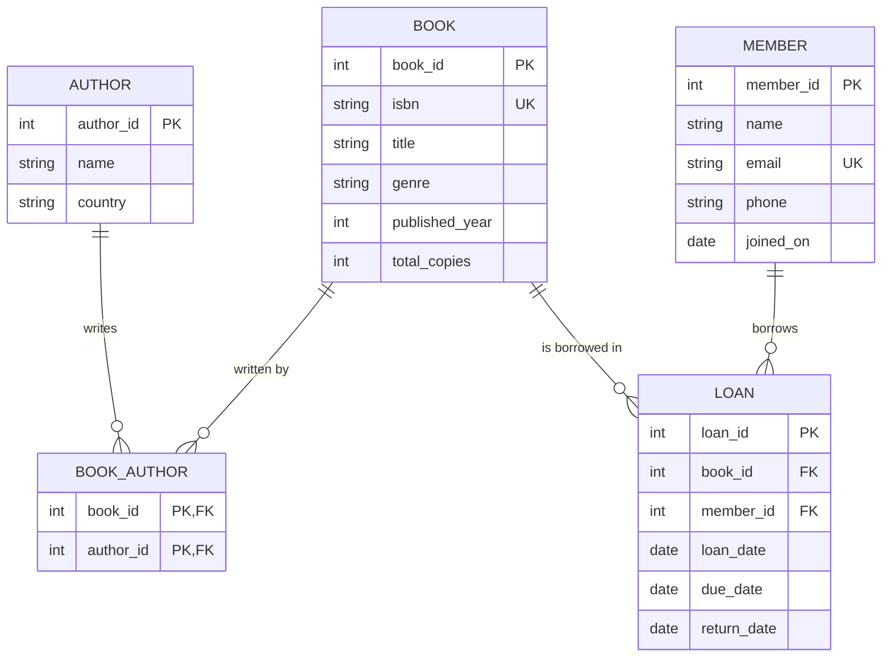
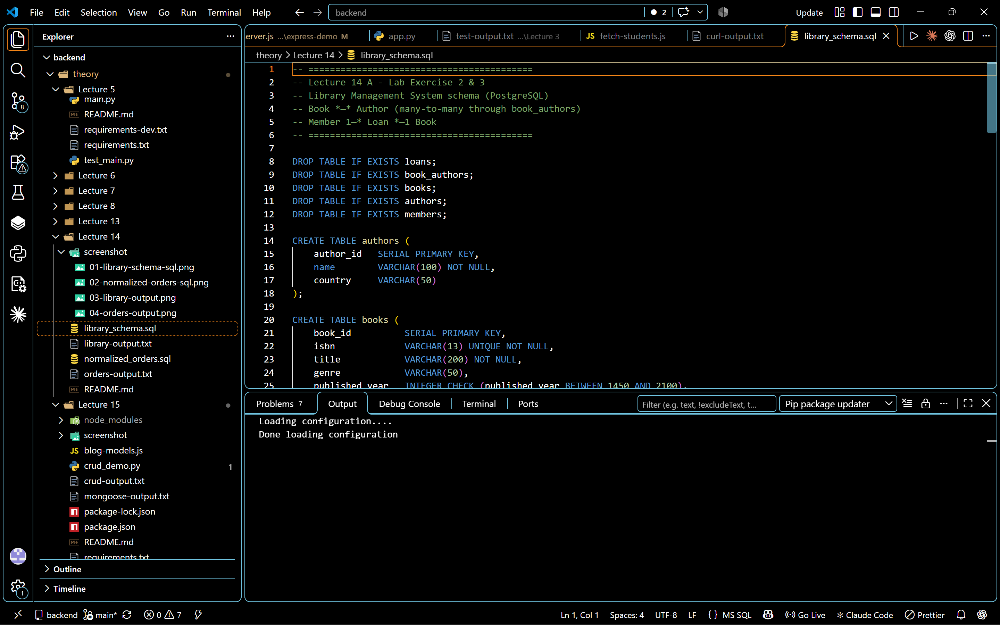
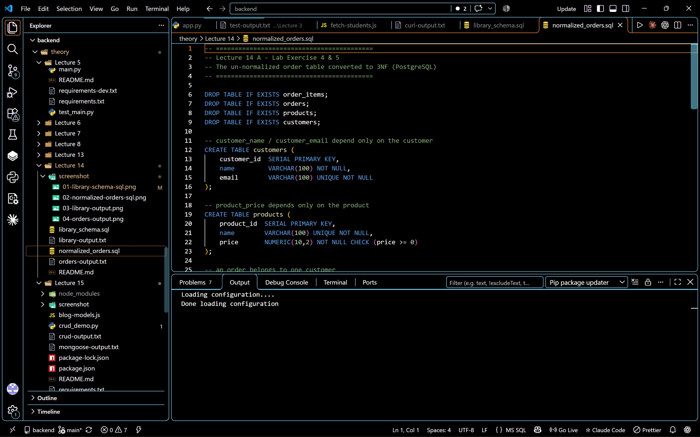
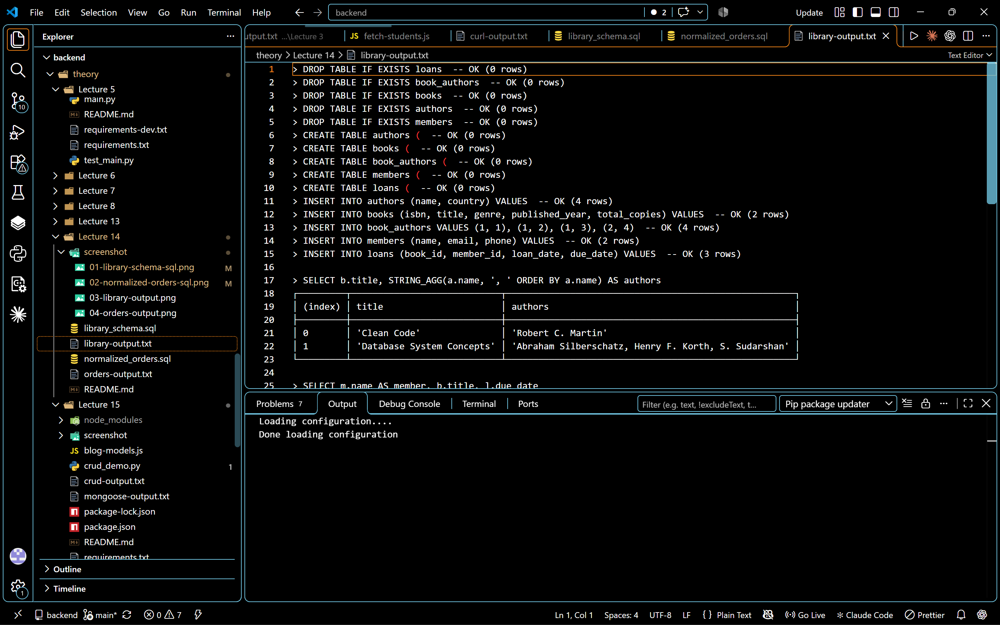
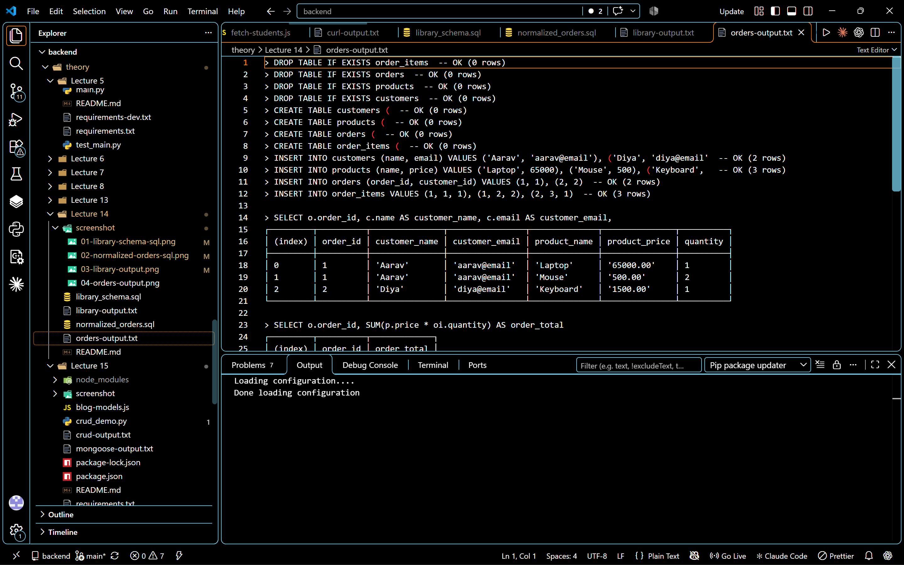

# Lecture 14 — Database Schema Design and Normalization

**Unit 2:** Databases and RESTful APIs

---

## Objective

Design a Library Management System schema with proper relationships and normalize an order table step-by-step to 3NF.

## Technologies

PostgreSQL, SQL, Mermaid ER diagrams

---

## Files

| File | Contents |
|---|---|
| `library_schema.sql` | CREATE TABLE with PK, FK, UNIQUE, CHECK, DEFAULT |
| `normalized_orders.sql` | 3NF tables + sample data + join query |
| `library-output.txt` | PGlite execution output |
| `orders-output.txt` | PGlite execution output |

## Lab Exercise

| # | Requirement | Where |
|---|---|---|
| 1 | ER diagram — Book, Member, Loan, Author | Diagram below |
| 2 | Schema with relationships (Book many-to-many Author, Member one-to-many Loan) | `library_schema.sql` |
| 3 | CREATE TABLE with PK, FK and constraints | `library_schema.sql` |
| 4 | Normalize the order table to 3NF | Section below |
| 5 | Create normalized tables + sample data | `normalized_orders.sql` |

---

## 1. ER Diagram — Library Management System



- **Book to Author** is many-to-many, resolved with the junction table `book_authors` (composite PK).
- **Member to Loan** and **Book to Loan** are one-to-many. `return_date IS NULL` means not returned yet.

## 4. Normalizing the Order Table to 3NF

Original table (candidate key = `{order_id, product_name}`):

| order_id | customer_name | customer_email | product_name | product_price | quantity |
|---|---|---|---|---|---|
| 1 | Aarav | aarav@email | Laptop | 65000 | 1 |
| 1 | Aarav | aarav@email | Mouse | 500 | 2 |
| 2 | Diya | diya@email | Keyboard | 1500 | 1 |

**1NF** — every cell is atomic and rows are unique by `(order_id, product_name)`. Already in 1NF. Problems: Aarav's name/email are repeated (update anomaly); a product cannot be stored without an order (insert anomaly); deleting order 2 loses the Keyboard price (delete anomaly).

**2NF** — remove partial dependencies: `product_price` depends only on `product_name` (table Products); customer data depends only on `order_id` (table Orders); `quantity` depends on the whole key (table Order_Items).

**3NF** — remove transitive dependencies: `order_id -> customer_email -> customer_name`, so customer details move to Customers and Orders keeps only `customer_id` (FK).

**Final 3NF schema:**

```
Customers   (customer_id PK, name, email UNIQUE)
Products    (product_id PK, name UNIQUE, price)
Orders      (order_id PK, customer_id FK -> Customers, order_date)
Order_Items (order_id FK -> Orders, product_id FK -> Products, quantity, PK(order_id, product_id))
```

Every non-key attribute depends on the key, the whole key and nothing but the key. The join query in `normalized_orders.sql` rebuilds the original rows exactly (lossless decomposition). In every table each determinant is a candidate key, so the schema is also in BCNF.

---


## Execution Screenshots

### Library Schema SQL

`library_schema.sql` in VS Code — CREATE TABLE statements for books, authors, members, loans and book_authors junction table.



### Normalized Orders SQL

`normalized_orders.sql` in VS Code — 3NF decomposition: Customers, Products, Orders and Order_Items tables.



### Library Query Output

`library-output.txt` in VS Code — query results showing multi-author book joins and active loan details.



### Orders Query Output

`orders-output.txt` in VS Code — JOIN query reconstructing the original denormalized rows from normalized tables.



---
<div align="center">

[Lecture 13](../Lecture%2013/README.md) | [Theory Index](../README.md) | [Lecture 15](../Lecture%2015/README.md)

</div>
