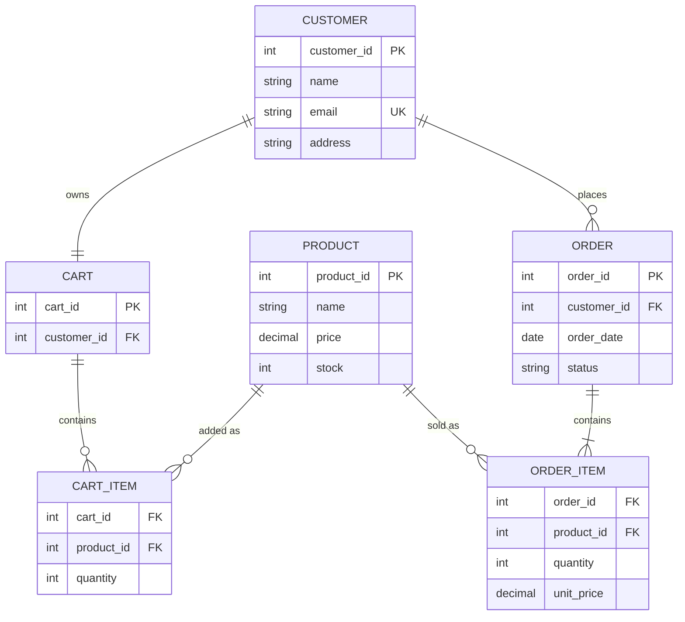
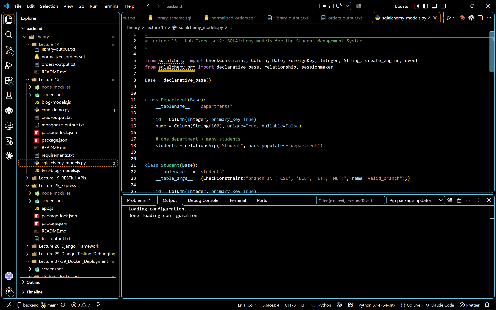
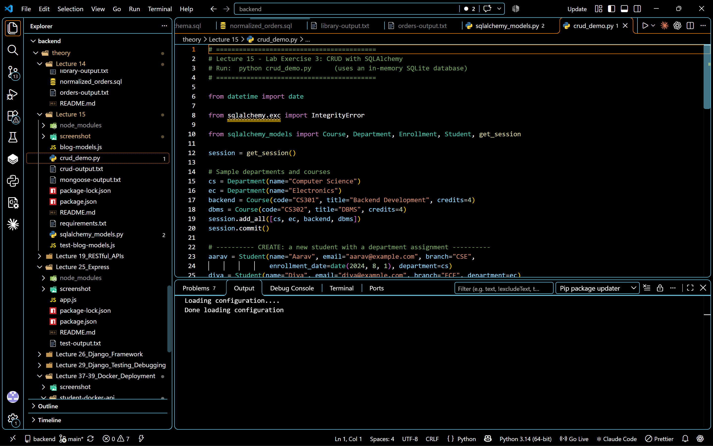
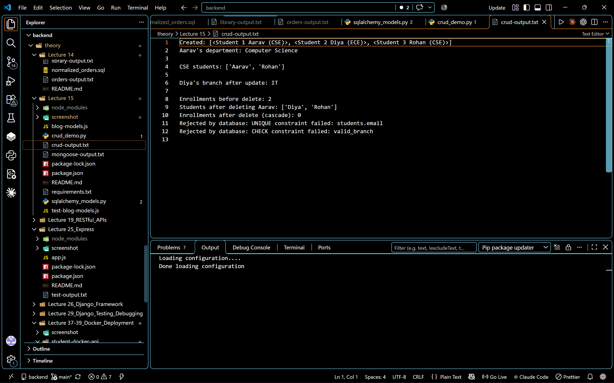
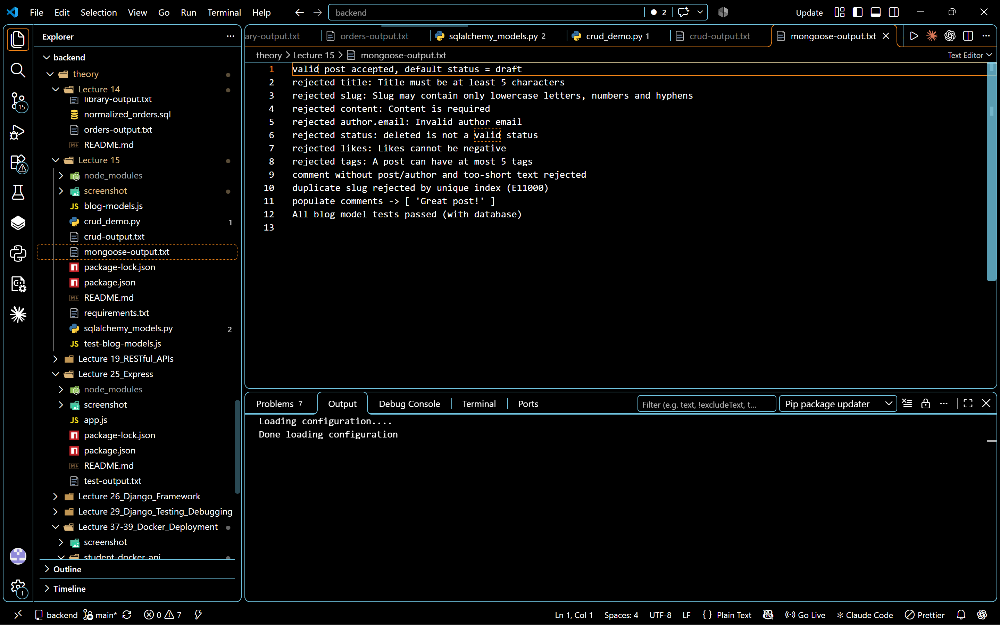

# Lecture 15 — Data Modeling (SQLAlchemy and Mongoose)

**Unit 2:** Databases and RESTful APIs

---

## Objective

Define conceptual, relational and document data models with relationships and validation rules.

## Technologies

Python, SQLAlchemy, Mongoose, MongoDB

---

## How to Run

```bash
pip install -r requirements.txt && python crud_demo.py        # SQLAlchemy (in-memory SQLite)
npm install && node test-blog-models.js                       # Mongoose validation
MONGO_URL=mongodb://127.0.0.1:27017/blog_test node test-blog-models.js   # + unique index and populate
```

## Lab Exercise

| # | Requirement | Where | Result |
|---|---|---|---|
| 1 | Conceptual model — E-Commerce (Product, Order, Customer, Cart) | Diagram below | — |
| 2 | SQLAlchemy models for Student Management with relationships | `sqlalchemy_models.py` | Department 1-to-many Student, Student many-to-many Course via Enrollment |
| 3 | CRUD: create with department, read by branch, update branch, delete + cascade | `crud_demo.py` | `crud-output.txt` — enrollments 2 to 0 after deleting the student |
| 4 | Mongoose schemas for Blog: Post and Comment | `blog-models.js` | Comment references Post by ObjectId; `post.comments` virtual populate |
| 5 | Validation rules (required, unique, enum) | Both files | `mongoose-output.txt`; SQL UNIQUE/CHECK errors in `crud-output.txt` |

---

## 1. Conceptual Data Model — E-Commerce



- A customer has one cart and many orders.
- Cart-Product and Order-Product are many-to-many, resolved by `CART_ITEM` and `ORDER_ITEM`.
- `ORDER_ITEM.unit_price` stores the price at the time of purchase (product price may change later).

## Validation Rules Used

| Rule | SQLAlchemy / SQL | Mongoose |
|---|---|---|
| Required | `nullable=False` | `required: [true, msg]` |
| Unique | `unique=True` (email) | `unique: true` (slug) — E11000 |
| Enum / allowed values | `CHECK (branch IN (...))` | `enum: ['draft','published','archived']` |
| Range / length | `CHECK (credits BETWEEN 1 AND 6)` | `minlength`, `maxlength`, `min` |
| Pattern | — | `match: /^\S+@\S+\.\S+$/` |
| Custom | — | `validate: tags.length <= 5` |

## SQL vs Document Modeling

- **Relational:** normalize into tables, link with foreign keys, join when reading.
- **Document:** embed data that is read together (author inside post), reference data that grows without limit (comments are a separate collection referencing the post).

---


## Execution Screenshots

### SQLAlchemy Models Code

`sqlalchemy_models.py` in VS Code — Department, Student and Enrollment ORM models with relationships and constraints.



### CRUD Demo Code

`crud_demo.py` in VS Code — demonstrates create, read, update, delete and constraint violation handling.



### SQLAlchemy Output

`crud-output.txt` in VS Code — CRUD operation results including cascade delete and constraint error messages.



### Mongoose Output

`mongoose-output.txt` in VS Code — blog schema validation, E11000 duplicate key error, and populate results.



---
<div align="center">

[Lecture 14](../Lecture%2014/README.md) | [Theory Index](../README.md) | [Lecture 19](../Lecture%2019_RESTful_APIs/README.md)

</div>
