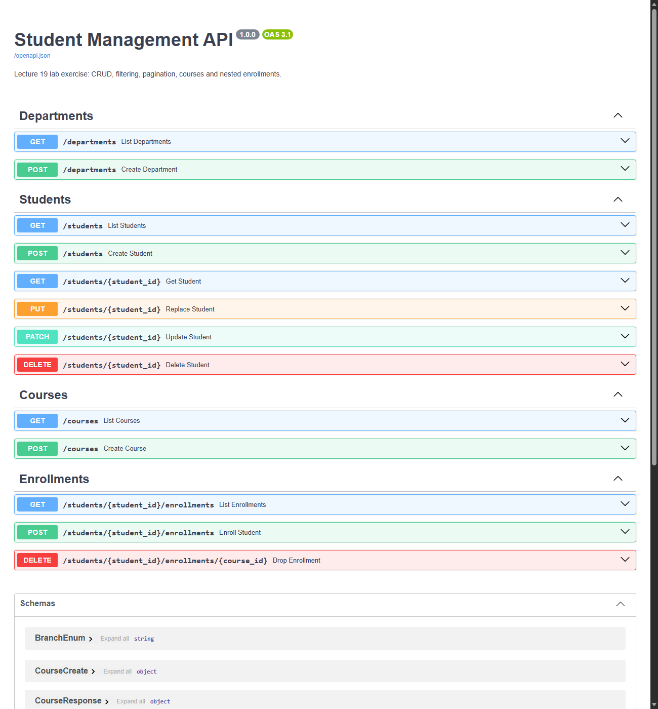

# Lecture 19 — Implementing RESTful APIs (Student Management)

**Unit 2:** Databases and RESTful APIs

---

## Objective

Build a full CRUD API with filtering, pagination, courses and nested enrollments using FastAPI and SQLAlchemy.

## Technologies

Python, FastAPI, SQLAlchemy, SQLite, Postman

---

## Folder Structure

```
Lecture 19_RESTful_APIs/
├── database.py        # engine, SessionLocal, get_db()
├── models.py          # Department, Student, Course, Enrollment
├── schemas.py         # Pydantic request / response models
├── main.py            # All endpoints
├── test_main.py       # 8 tests (in-memory database)
├── Student-API.postman_collection.json
├── curl-demo.txt      # Example requests and responses
└── screenshots/swagger-ui.png
```

## How to Run

```bash
python -m venv venv
venv\Scripts\activate
pip install -r requirements.txt -r requirements-dev.txt
uvicorn main:app --reload      # creates students.db (ignored by Git)
pytest -v
```

---

## Lab Exercise

| # | Requirement | Implementation |
|:-:|---|---|
| 1 | Complete student CRUD | GET, GET /{id}, POST, PUT, PATCH, DELETE |
| 2 | Filtering | `?branch=CSE`, `?department_id=1`, `?search=` (name or email) |
| 3 | Pagination metadata | `data, total, page, limit, total_pages` |
| 4 | `POST /courses` + Postman | Endpoint + `Student-API.postman_collection.json` |
| 5 | Nested enrollments | `GET/POST /students/{id}/enrollments`, `DELETE .../enrollments/{course_id}` |
| 6 | Error handling | 404 missing, 409 duplicate, 422 invalid data |
| 7 | Swagger UI docs | Endpoints grouped by tags |

## Data Model

```
Department 1 --< Student 1 --< Enrollment >-- 1 Course >-- 1 Department
```

Deleting a student also deletes their enrollments (`cascade="all, delete-orphan"`).

## Status Codes

| Code | When |
|:-:|---|
| 200 | Successful GET / PUT / PATCH |
| 201 | Resource created |
| 204 | Deleted |
| 404 | ID does not exist |
| 409 | Duplicate email, course id or enrollment |
| 422 | Invalid body or query |

## Swagger UI



---


## Execution Screenshots

**Student Management API Swagger documentation**


---
<div align="center">

[Lecture 15](../Lecture%2015/README.md) | [Theory Index](../README.md) | [Lecture 25](../Lecture%2025_Express/README.md)

</div>
