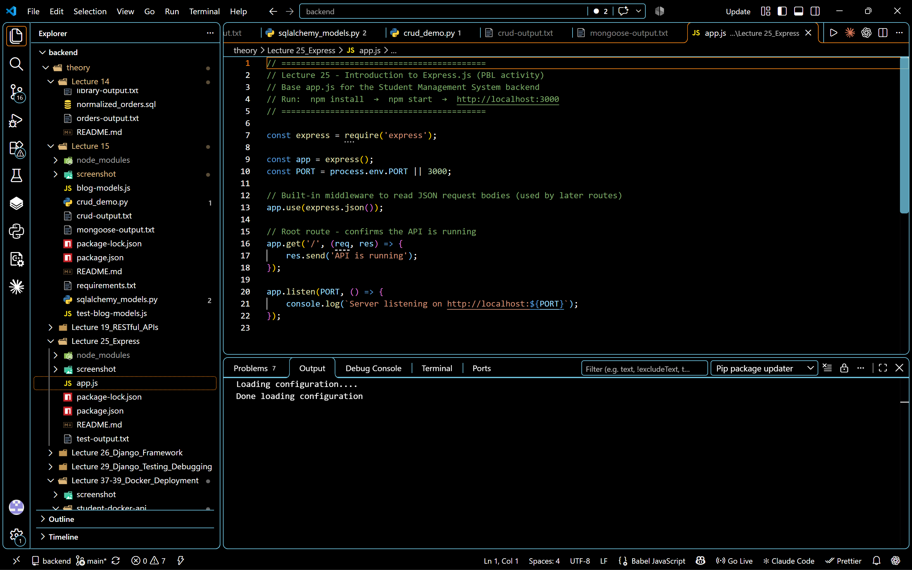
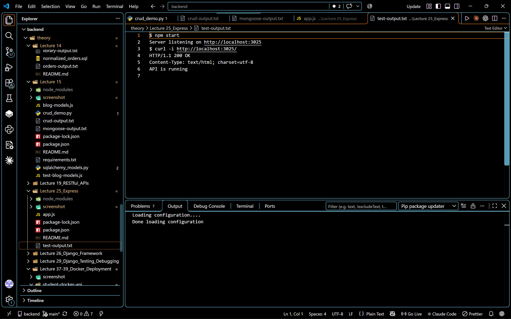

# Lecture 25 — Introduction to Express.js

**Unit 3:** Backend Frameworks

---

## Objective

Set up an Express project and an `app.js` that answers "API is running" on `/`.

## Technologies

Node.js, Express.js, nodemon

---

## Folder Structure

```
Lecture 25_Express/
├── app.js            # Express server
├── package.json      # scripts: start, dev
└── test-output.txt   # curl result
```

## How to Run

```bash
npm install
npm start        # node app.js
npm run dev      # nodemon app.js — auto-restart on changes
```

---

## Assessment Criteria

| Criterion | Evidence |
|---|---|
| Environment setup — correct `package.json` | name, `main: app.js`, scripts `start`/`dev`, `express` dependency, `nodemon` dev dependency |
| Server listens and responds to `/` | `HTTP/1.1 200 OK` with body `API is running` |

---


## Execution Screenshots

### Express App Code

`app.js` in VS Code — Express server setup with middleware and route configuration.



### Test Output

`test-output.txt` in VS Code — server startup confirmation and curl response showing `API is running`.



---
<div align="center">

[Lecture 19](../Lecture%2019_RESTful_APIs/README.md) | [Theory Index](../README.md) | [Lecture 26](../Lecture%2026_Django_Framework/README.md)

</div>
