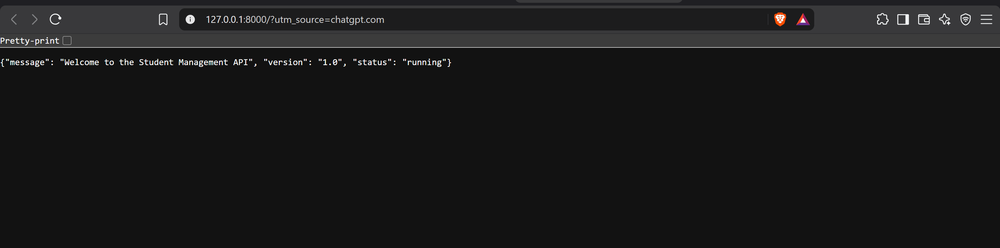

# Lecture 26 — Django Framework (Student Management API)

**Unit 3:** Backend Frameworks | Covers Lectures 26–31

---

## Objective

Build one Django project extended lecture by lecture: middleware, third-party APIs, testing, security and caching.

## Technologies

Python, Django, SQLite, uv

---

## Folder Structure

```
Lecture 26_Django_Framework/
├── student_system/        # settings.py (middleware, LOGIN_URL, CACHES, LOGGING), urls.py
├── students/
│   ├── models.py          # Department, Course, Student (FK + M2M)
│   ├── views.py           # JSON endpoints
│   ├── urls.py            # Named routes
│   ├── middleware.py      # Request logging (L27)
│   ├── utils.py           # External API service (L28)
│   ├── tests.py           # 19 tests (L29)
│   └── templates/registration/login.html   # (L30)
├── test-output.txt
├── request-log-output.txt
├── performance-output.txt
└── screenshots/
```

## How to Run

```bash
uv sync
uv run python manage.py migrate
uv run python manage.py createsuperuser
uv run python manage.py runserver
uv run python manage.py test students
```

---

## What Each Lecture Added

| Lecture | Feature |
|:-:|---|
| **26** | Project + app, `GET /` welcome JSON |
| **27** | `SimpleLoggingMiddleware` (method, path, status, time + `X-Response-Time-ms`), health / list / detail routes |
| **28** | `requests` service with a 2 s timeout, 503 when the external API fails |
| **29** | Tests for endpoints, models and a mocked external service |
| **30** | Login page, `@login_required`, `@permission_required("students.view_student")` |
| **31** | N+1 fix with `select_related` + `prefetch_related`, 5-minute cached summary |

## Endpoints

| URL | Name | Notes |
|---|---|---|
| `/` | `home` | Welcome JSON |
| `/api/health/` | `health-check` | `{"status": "ok"}` |
| `/api/students/` | `student-list` | Optimized — 2 queries |
| `/api/students/<id>/` | `student-detail` | 404 JSON if missing |
| `/api/students/unoptimized/` | `student-list-unoptimized` | N+1 version for comparison |
| `/api/students/summary/` | `student-summary` | Cached 300 s |
| `/api/students/external/<post_id>/` | `external-data` | JSONPlaceholder post or 503 |
| `/secure-data/` | `secure-data` | Login required |
| `/student-records/` | `student-records` | Needs permission |
| `/accounts/login/` | — | Django auth |
| `/admin/` | — | Django admin |

## Results

| Check | Result |
|---|---|
| Test suite | 19 tests OK |
| Anonymous accessing `/secure-data/` | 302 redirect to login |
| Regular user accessing `/student-records/` | 403 |
| Student list, 50 students | 101 queries reduced to 2, 103 ms to 6 ms |
| Cached summary, 2nd request | 0 queries |

Evidence: [test-output.txt](test-output.txt), [request-log-output.txt](request-log-output.txt), [performance-output.txt](performance-output.txt)

## Screenshot



---


## Execution Screenshots

**Django Student API response**


---
<div align="center">

[Lecture 25](../Lecture%2025_Express/README.md) | [Theory Index](../README.md) | [Lecture 29](../Lecture%2029_Django_Testing_Debugging/README.md)

</div>
