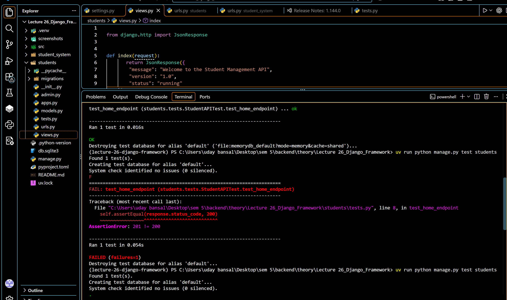
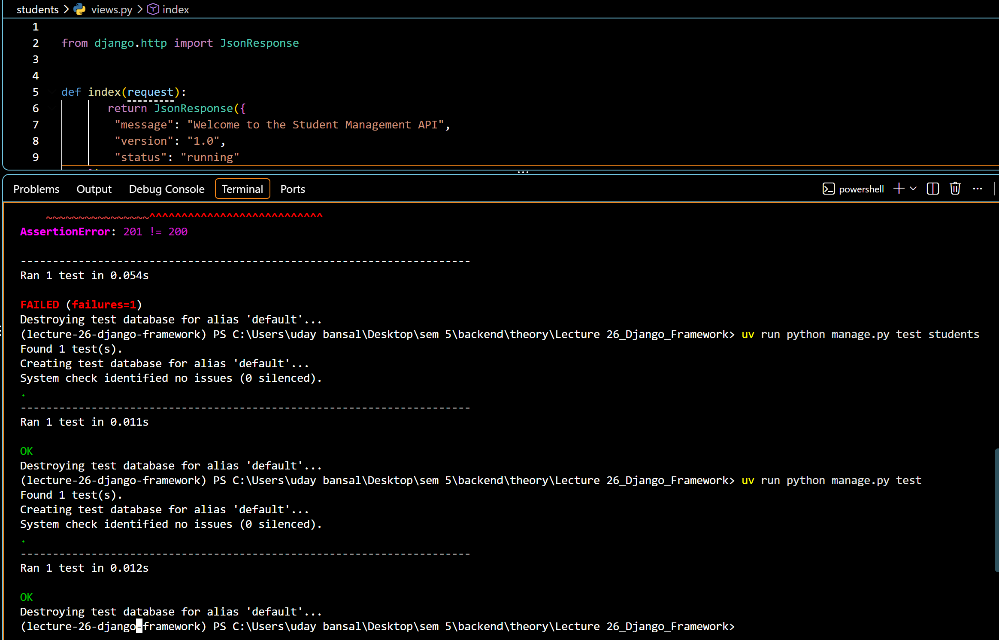

# Lecture 29 — Testing and Debugging Django Applications

**Unit 3:** Backend Frameworks

---

## Objective

Write automated tests for the Student Management API and use a systematic approach to find bugs.

## Technologies

Django, unittest, unittest.mock

---

## Files

```
Lecture 29_Django_Testing_Debugging/
├── lecture29_observation.txt   # Objective, steps and result
└── screenshots/
    ├── lecture29_debugging_failure.png
    └── lecture29_test_success.png
```

The test code lives in [`../Lecture 26_Django_Framework/students/tests.py`](../Lecture%2026_Django_Framework/students/tests.py).

## How to Run

```bash
cd "../Lecture 26_Django_Framework"
uv run python manage.py test students -v 2
```

---

## What Was Tested

| Requirement | Test Class |
|---|---|
| Health, list and detail endpoints (named URLs with `reverse()`) | `StudentEndpointTests` |
| 404 path with status and error message | `StudentEndpointTests` |
| Model behaviour (`__str__`, `to_dict`, unique email) | `StudentModelTests` |
| External service mocked — success and timeout | `ExternalServiceTests` (`@patch("students.utils.requests.get")`) |

## Debugging Exercises

| Defect Introduced | What the Tests Showed | Fix |
|---|---|---|
| Expected status changed 200 to 201 | Assertion failure (see screenshot) | Restored the correct status |
| URL converter `<int:student_id>` changed to `<int:id>` | `NoReverseMatch` in tests, `TypeError: unexpected keyword argument 'id'` (HTTP 500) | Renamed the converter back |

Result: **19 tests OK**. Test data is created inside each test, and Django uses a separate test database.

## Screenshots

| Intentional Failure | All Tests Passing |
|:-:|:-:|
|  |  |

---

<div align="center">

[Lecture 26](../Lecture%2026_Django_Framework/README.md) | [Theory Index](../README.md) | [Lecture 37-39](../Lecture%2037-39_Docker_Deployment/README.md)

</div>
