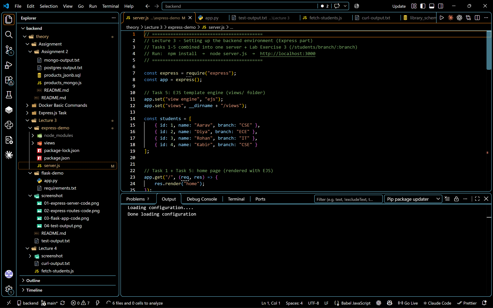
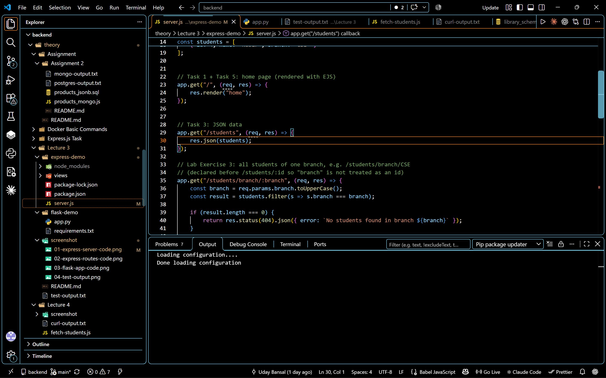
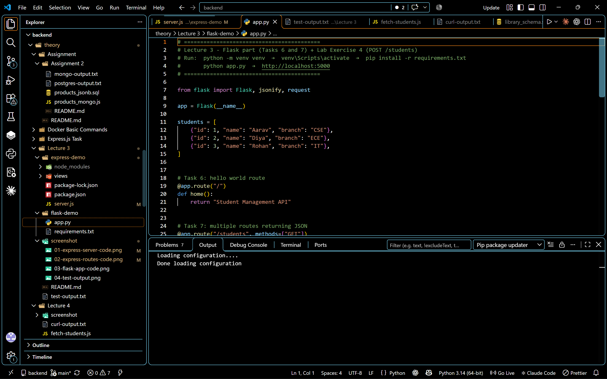
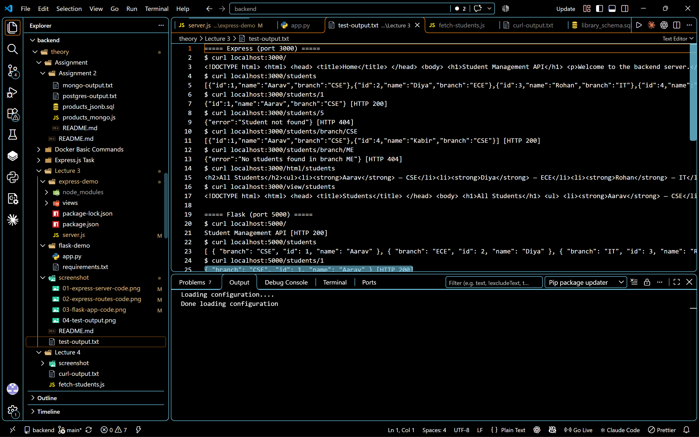

# Lecture 3 — Setting Up the Backend Environment

**Unit 1:** Introduction to Backend Development

---

## Objective

Build the same small Student API twice — with Express and with Flask — from "Hello World" to JSON and templates.

## Technologies

Node.js, Express.js, EJS, Python, Flask

---

## Folder Structure

```
Lecture 3/
├── express-demo/
│   ├── server.js          # Tasks 1–5 + /students/branch/:branch
│   └── views/             # home.ejs, students.ejs
├── flask-demo/
│   ├── app.py             # Tasks 6–7 + POST /students
│   └── requirements.txt
└── test-output.txt        # curl results for both servers
```

## How to Run

```bash
# Express
cd express-demo
npm install
node server.js                   # http://localhost:3000

# Flask
cd flask-demo
python -m venv venv
venv\Scripts\activate
pip install -r requirements.txt
python app.py                    # http://localhost:5000
```

---

## Hands-on Tasks

| # | Task | Implementation |
|:-:|---|---|
| 1 | Hello world server | `express-demo/server.js` |
| 2 | Multiple routes | `/`, `/students`, `/students/:id` |
| 3 | Returning JSON | `GET /students`, `GET /students/:id` (404 JSON error) |
| 4 | HTML responses | `GET /html/students` |
| 5 | EJS templating | `GET /view/students` with `views/students.ejs` |
| 6 | Flask hello world | `flask-demo/app.py` |
| 7 | Flask routes + JSON | `/students`, `/students/<int:id>` |
| 8 | Browser DevTools | Network tab: request method, status, headers, body |

## Lab Exercise

| # | Requirement | Result |
|:-:|---|---|
| 1 | Install Node.js, npm, Python, venv, VS Code | Done |
| 2 | Complete all eight tasks | Done |
| 3 | `GET /students/branch/:branch` | `/students/branch/CSE` returns Aarav, Kabir; unknown branch returns 404 |
| 4 | Flask `POST /students` | 201 with the new student; 400 if fields are missing |
| 5 | DevTools screenshot of one API call | Open `http://localhost:3000/students`, F12, Network |

All routes tested with curl: [test-output.txt](test-output.txt)

## Key Concept

`/students/branch/:branch` is declared before `/students/:id` because Express matches routes in order — otherwise `branch` would be treated as an id.

---


## Execution Screenshots

### Express Server Code

Express `server.js` open in VS Code — route definitions for JSON API, HTML responses, and EJS template rendering.



### Express Routes (continued)

More Express routes: branch filter, 404 handling, and `app.listen()` on port 3000.



### Flask Application Code

Flask `app.py` open in VS Code — equivalent REST endpoints with `@app.route` decorators.



### Test Output

Test results from `test-output.txt` showing curl responses from both Express and Flask servers.



---
<div align="center">

[Theory Index](../README.md) | [Lecture 4](../Lecture%204/README.md) | [Repository Home](../../README.md)

</div>
