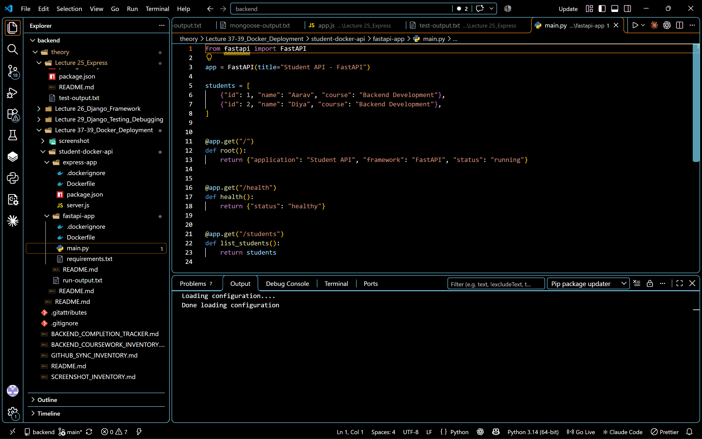
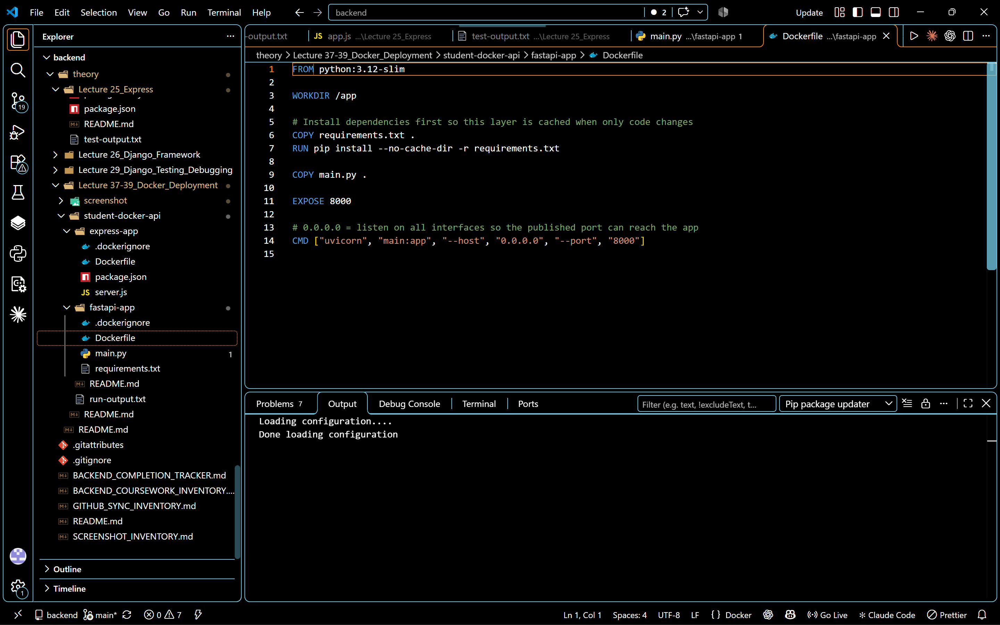
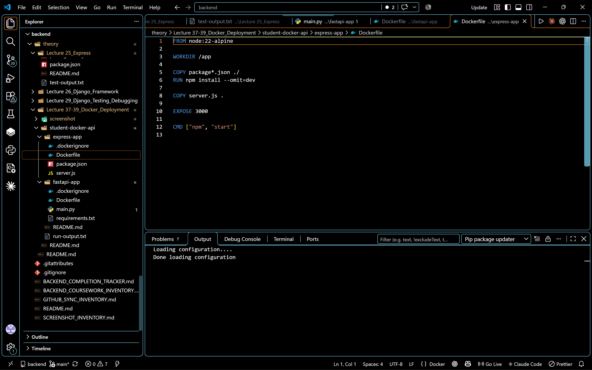
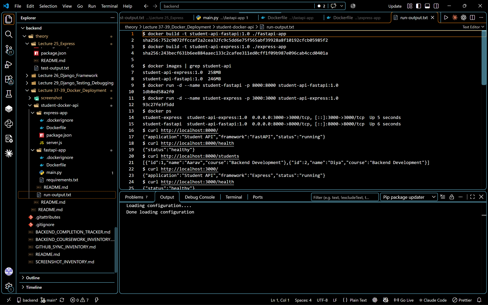

# Lectures 37–39 — Deployment, Containerization and Docker

**Unit 4:** Deployment, CI/CD and Scaling

---

## Objective

Implement the same Student API contract in FastAPI and Express, then package both as portable Docker images.

## Technologies

Docker, FastAPI, Express.js

---

## Folder Structure

```
Lecture 37-39_Docker_Deployment/
└── student-docker-api/
    ├── fastapi-app/   main.py, requirements.txt, Dockerfile, .dockerignore
    ├── express-app/   server.js, package.json, Dockerfile, .dockerignore
    ├── run-output.txt
    └── README.md      # Build/run commands, results, problem and solution, exit answers
```

## Quick Start

```bash
cd student-docker-api
docker build -t student-api-fastapi:1.0 ./fastapi-app
docker build -t student-api-express:1.0 ./express-app
docker run -d --name student-fastapi -p 8000:8000 student-api-fastapi:1.0
docker run -d --name student-express -p 3000:3000 student-api-express:1.0
curl http://localhost:8000/health && curl http://localhost:3000/health
```

## Related Docker Work

| Folder | Contents |
|---|---|
| [Docker Basic Commands](../Docker%20Basic%20Commands/README.md) | nginx container, custom image, export/restore |
| [Express.js Task](../Express.js%20Task/README.md) | Express app containerized and exported as a `.tar` |

---


## Execution Screenshots

### FastAPI Main Code

FastAPI `main.py` in VS Code — Student CRUD API with SQLite, Pydantic models, and structured logging.



### FastAPI Dockerfile

FastAPI `Dockerfile` in VS Code — multi-stage build with cached dependencies and non-root user.



### Express Dockerfile

Express `Dockerfile` in VS Code — Node.js container with npm ci and production configuration.



### Docker Run Output

`run-output.txt` in VS Code — Docker build, run and curl test results for both containers.



---
<div align="center">

[Lecture 29](../Lecture%2029_Django_Testing_Debugging/README.md) | [Theory Index](../README.md) | [PBL Assignment](https://github.com/UdayBansal0109/Backend-PBL)

</div>
