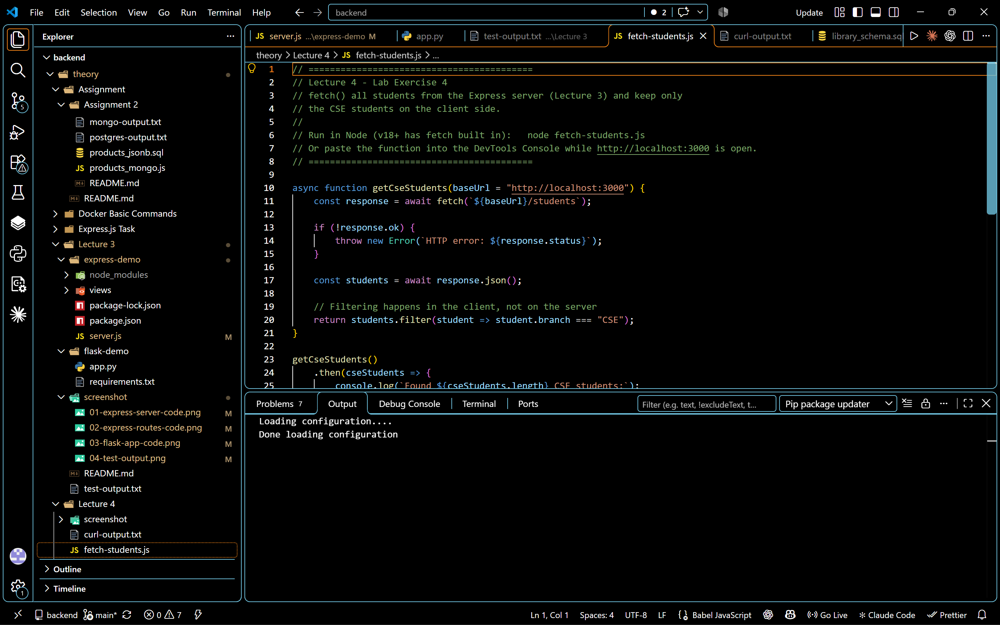
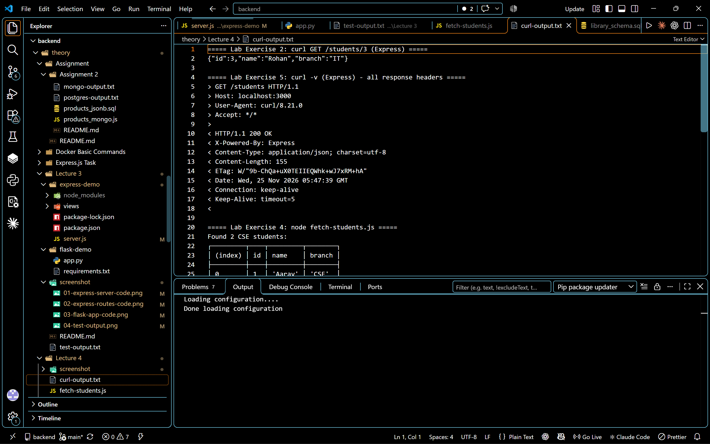
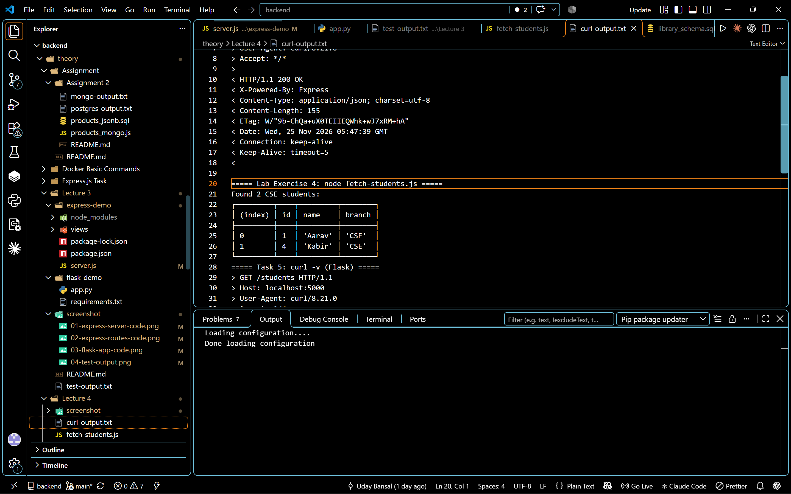

# Lecture 4 — HTTP Requests, DevTools, curl, Postman and fetch

**Unit 1:** Introduction to Backend Development

---

## Objective

Inspect the same HTTP request with four different tools: browser DevTools, curl, Postman and `fetch()`.

## Technologies

HTTP, curl, Postman, JavaScript fetch API

---

## Folder Structure

```
Lecture 4/
├── fetch-students.js                    # fetch() + client-side filter for CSE
├── Student-API.postman_collection.json  # Import into Postman
└── curl-output.txt                      # curl and curl -v results
```

## How to Run

```bash
# Start the Lecture 3 servers first, then:
node fetch-students.js
curl http://localhost:3000/students/3
curl -v http://localhost:3000/students
```

Postman: **File, Import**, select `Student-API.postman_collection.json`.

---

## Lab Exercise

| # | Requirement | Result |
|:-:|---|---|
| 1 | DevTools screenshot of `GET /students` | Capture in the browser (F12, Network) |
| 2 | curl `/students/3` and verify | `{"id":3,"name":"Rohan","branch":"IT"}` |
| 3 | Postman request to Flask, saved in a collection | `Student-API.postman_collection.json` |
| 4 | `fetch()` all students, filter CSE in the client | 2 students: Aarav, Kabir |
| 5 | `curl -v` — Express response headers | See table below |

## Express Response Headers (`curl -v`)

| Header | Meaning |
|---|---|
| `HTTP/1.1 200 OK` | Status line |
| `X-Powered-By: Express` | Framework name (disable in production with `app.disable('x-powered-by')`) |
| `Content-Type: application/json; charset=utf-8` | Set by `res.json()` |
| `Content-Length: 155` | Body size in bytes |
| `ETag: W/"9b-…"` | Version tag for caching (304 Not Modified) |
| `Connection: keep-alive` | The TCP connection is reused |

Flask answers with `Server: Werkzeug/3.1.9` and `Connection: close` — same HTTP structure, different server. HTTP is a protocol, independent of the framework.

## Anatomy of an HTTP Exchange

```
GET /students HTTP/1.1          <- method, path, version
Host: localhost:3000            <- headers
Accept: */*
                                <- blank line (+ optional body)

HTTP/1.1 200 OK                 <- version, status code, reason
Content-Type: application/json  <- headers
                                <- blank line
[{"id":1, ...}]                 <- body
```

---


## Execution Screenshots

### Fetch Students Code

`fetch-students.js` open in VS Code — uses `fetch()` to call the Express API and display students in a formatted table.



### curl Output

`curl-output.txt` in VS Code — raw HTTP responses from `curl` commands against the Express server.



### curl Verbose Output

Continued curl output showing verbose `-v` headers: request/response headers, status codes, and content types.



---
<div align="center">

[Lecture 3](../Lecture%203/README.md) | [Theory Index](../README.md) | [Lecture 5](../Lecture%205/README.md)

</div>
