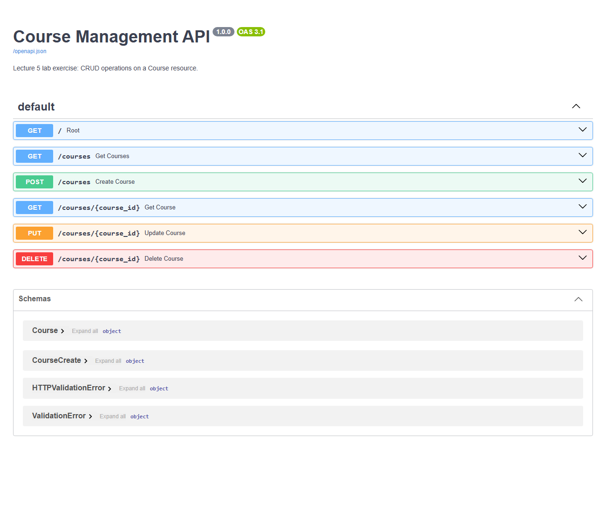
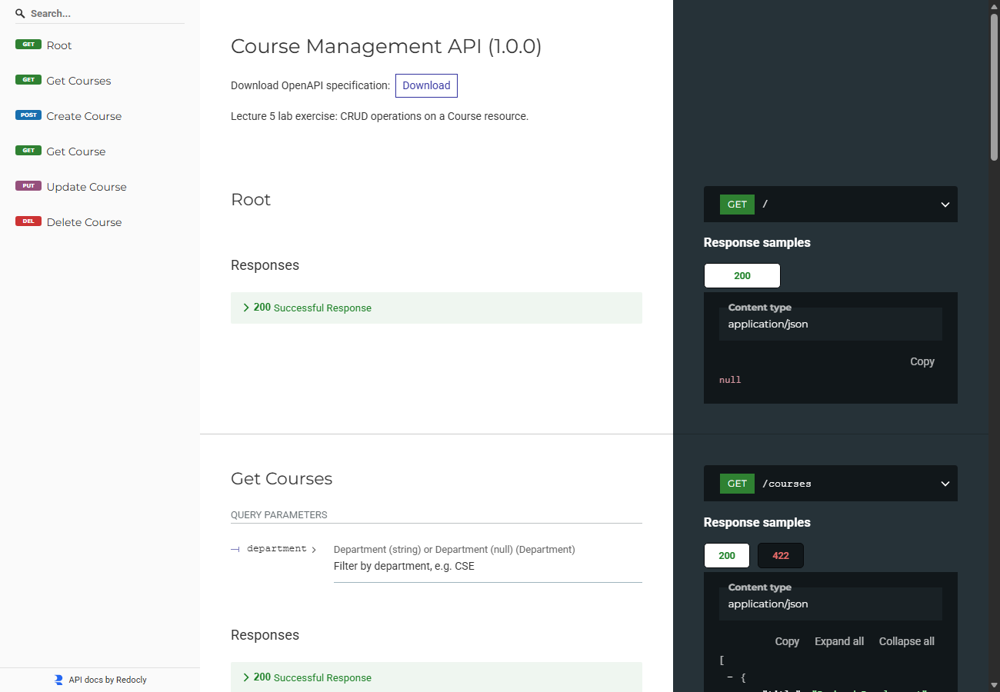

# Lecture 5 — RESTful APIs with FastAPI

**Unit 1:** Introduction to Backend Development

---

## Objective

Build a complete CRUD API for a Course resource with automatic Swagger and ReDoc documentation.

## Technologies

Python, FastAPI, uvicorn, pytest

---

## Folder Structure

```
Lecture 5/
├── main.py                 # Course API
├── test_main.py            # 6 pytest tests
├── requirements.txt        # fastapi, uvicorn
├── requirements-dev.txt    # pytest, httpx
└── screenshots/            # swagger-ui.png, redoc.png
```

## How to Run

```bash
python -m venv venv
venv\Scripts\activate
pip install -r requirements.txt -r requirements-dev.txt
uvicorn main:app --reload        # http://127.0.0.1:8000/docs
pytest -v
```

---

## Lab Exercise

| # | Requirement | Implementation |
|:-:|---|---|
| 1 | Course: `id, title, credits, department` | Pydantic `CourseCreate` / `Course` (title >= 3 chars, credits 1–6) |
| 2 | Five CRUD operations | GET all, GET by id, POST, PUT, DELETE |
| 3 | Swagger UI + screenshot | `screenshots/swagger-ui.png` |
| 4 | ReDoc | `screenshots/redoc.png` |
| 5 | Filter `GET /courses?department=CSE` | Optional, case-insensitive query parameter |

## REST Mapping

| Method | URL | Action | Success |
|:-:|---|---|:-:|
| `GET` | `/courses` | Read all (optional `?department=`) | 200 |
| `GET` | `/courses/{id}` | Read one | 200 |
| `POST` | `/courses` | Create | 201 |
| `PUT` | `/courses/{id}` | Replace | 200 |
| `DELETE` | `/courses/{id}` | Delete | 204 |

Errors: unknown id returns 404; invalid body (e.g. `credits: 10`) returns 422.

## Screenshots

| Swagger UI | ReDoc |
|:-:|:-:|
|  |  |

---

<div align="center">

[Lecture 4](../Lecture%204/README.md) | [Theory Index](../README.md) | [Lecture 6](../Lecture%206/README.md)

</div>
