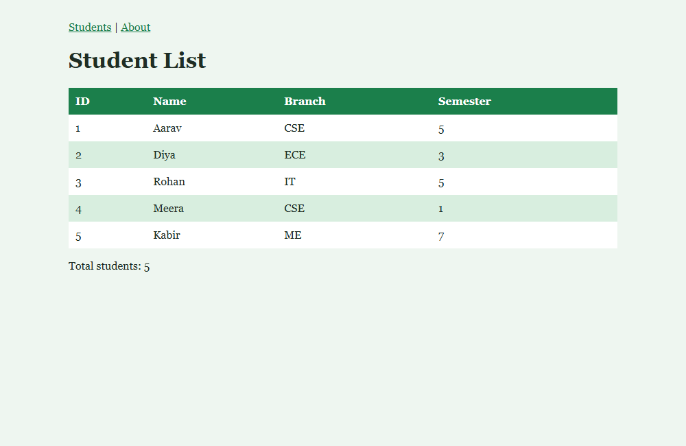
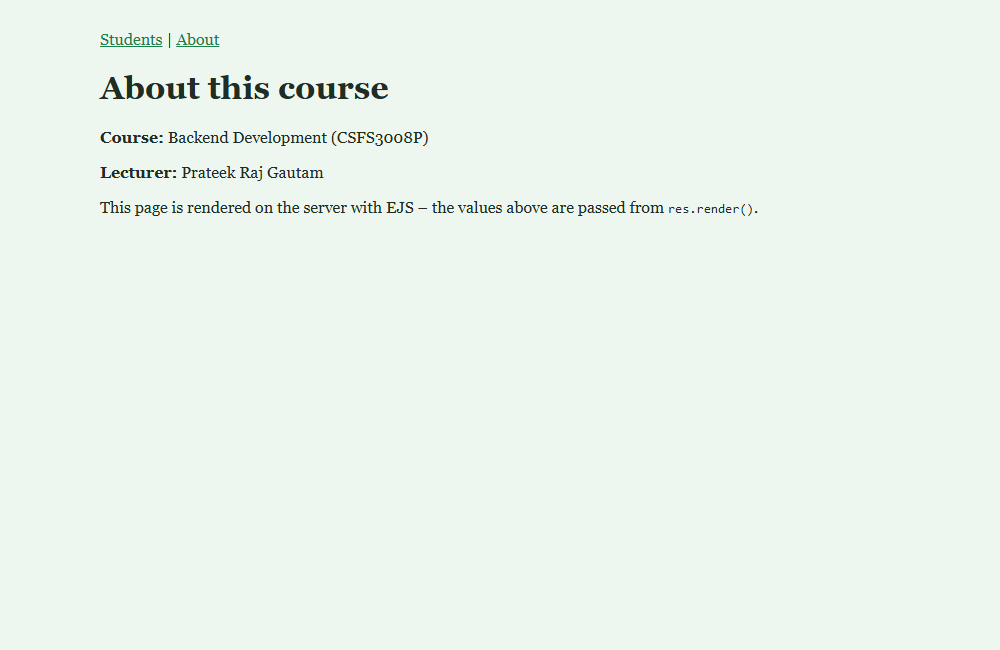
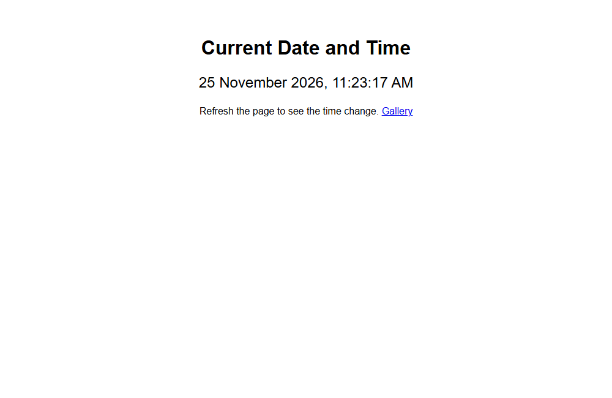
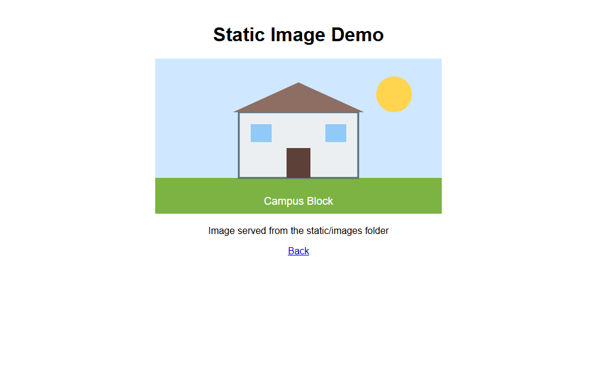

# Lecture 8 — Server-Side Rendering and Templating Engines

**Unit 1:** Introduction to Backend Development

---

## Objective

Build HTML on the server with EJS (Express) and Jinja2 (FastAPI), and serve static files.

## Technologies

Express.js, EJS, FastAPI, Jinja2

---

## Folder Structure

```
Lecture 8/
├── express-ssr/
│   ├── server.js
│   ├── views/            # students.ejs, about.ejs
│   └── public/css/       # style.css
├── fastapi-jinja/
│   ├── main.py
│   ├── templates/        # time.html, gallery.html
│   └── static/images/    # campus.svg
├── screenshots/
└── test-output.txt
```

## How to Run

```bash
cd express-ssr && npm install && node server.js                                   # http://localhost:3000
cd fastapi-jinja && pip install -r requirements.txt && uvicorn main:app --reload  # http://127.0.0.1:8000
```

---

## Lab Exercise

| # | Requirement | Implementation |
|:-:|---|---|
| 1 | Student table with alternating row colours | `row-even` / `row-odd` from the loop index |
| 2 | EJS `GET /about` with course + lecturer variables | `res.render("about", { courseName, lecturerName })` |
| 3 | FastAPI page with current date/time `{{ now }}` | `templates/time.html` |
| 4 | Custom CSS file served by Express | `express.static("public")` returns 200 text/css |
| 5 | FastAPI image from `static/images/` in a template | `StaticFiles` + `url_for('static', path=...)` |

## Screenshots

| Student Table (Ex 1, 4) | About Page (Ex 2) |
|:-:|:-:|
|  |  |
| **Date and Time (Ex 3)** | **Static Image (Ex 5)** |
|  |  |

## SSR vs CSR

| | Server-Side Rendering | Client-Side Rendering |
|---|---|---|
| HTML built by | Server (EJS / Jinja2) | Browser JavaScript |
| Server sends | Full HTML page | JSON |
| First load and SEO | Fast, crawlable | Slower, needs JS |

`<%= %>` and `{{ }}` escape HTML automatically, providing protection against XSS.

---

<div align="center">

[Lecture 7](../Lecture%207/README.md) | [Theory Index](../README.md) | [Lecture 13](../Lecture%2013/README.md)

</div>
